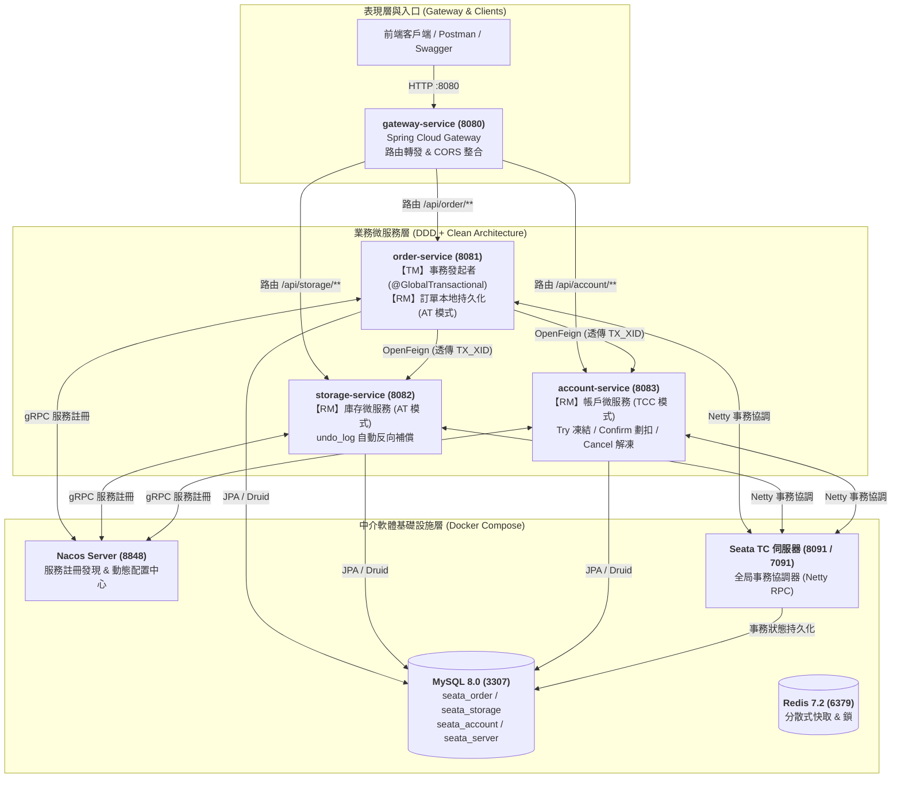

# Apache Seata 分散式事務架構全景與企業級落地實戰

> **基於 Java 21、Spring Boot 3.3.4、Spring Cloud 2023、Apache Seata 2.0.0、領域驅動設計 (DDD) 與六角形架構 (Clean Architecture) 的高可用微服務分散式事務示範專案。**

[](https://openjdk.org/projects/jdk/21/)
[](https://spring.io/projects/spring-boot)
[](https://spring.io/projects/spring-cloud)
[](https://seata.apache.org/)
[](LICENSE)

---

## 目錄導引

- [一、 專案核心特色與架構準則](#一-專案核心特色與架構準則)
- [二、 系統全景與服務拓撲](#二-系統全景與服務拓撲)
- [三、 業務與 RPC API 快速規格表](#三-業務與-rpc-api-快速規格表)
- [四、 5 分鐘快速啟動與上手指南](#四-5-分鐘快速啟動與上手指南)
- [五、 端到端 (E2E) 核心測試情境](#五-端到端-e2e-核心測試情境)
- [六、 專案目錄與模組職責說明](#六-專案目錄與模組職責說明)
- [七、 深度架構文檔導覽 (Docs Index)](#七-深度架構文檔導覽-docs-index)

---

## 一、 專案核心特色與架構準則

本專案遵循嚴格的企業級設計準則（參見 [.agents/AGENTS.md](file:///d:/桌面/MonoRepository/seata-architecture/.agents/AGENTS.md)），完美融合分散式事務機制與純粹的領域模型：

1. **AT + TCC 混合分散式事務矩陣**：
   - **Order Service (TM + AT RM)**：發起全局事務 (`@GlobalTransactional`)，協調全鏈路扣減庫存與資金預留。
   - **Storage Service (AT RM)**：基於 Seata AT 模式，透過自動截取 `before-image` 與 `after-image` 寫入 `undo_log`，實現無業務侵入的二階段提交與回滾。
   - **Account Service (TCC RM)**：基於 TCC 模式，實作一階段 `prepare` 預留凍結款項、二階段 `confirm` 劃扣與 `cancel` 自動解凍，內建防空回滾、防懸掛與冪等性控制表 (`t_tcc_transaction_record`)。
2. **純粹的領域驅動設計 (Domain-Driven Design, DDD)**：
   - 核心領域模型（`Order`, `Storage`, `Account`）採用 **Pure Java** 撰寫，**零框架依賴**、**零資料庫 ORM 侵入**，且聚合根內部**嚴格禁止 Lombok**，確保業務封裝性。
3. **六角形架構 / Ports & Adapters (Clean Architecture)**：
   - **Inbound Port**：應用層業務契約一律定義為 `UseCase`（如 `CreateOrderUseCase`, `GetStorageUseCase`）。
   - **Outbound Port**：外部依賴一律定義為 `Port`（如 `OrderRepositoryPort`, `StorageClientPort`）。
   - **純資料載體防腐機制**：Request (`V+N+Resource`) 與 Response (`N+Ved+Resource`) 不得包含轉換邏輯，一律交由 `assembler/` 負責轉換。
4. **業務查詢 API 與自動數據初始化**：
   - 各微服務皆具備商業語意的即時查詢 API，無須操作資料庫即可透過 HTTP / Swagger 驗證全鏈路狀態。
   - 微服務啟動時自動透過 `DataInitializationConfig` 校準基準測試數據，重啟即回歸初始測試狀態。

---

## 二、 系統全景與服務拓撲

### 1. 架構循序與拓撲圖



### 2. 微服務端點與中介軟體通訊矩陣

| 服務名稱 | 連接埠 (Port) | 職責說明 | Swagger API 文檔 |
| :--- | :--- | :--- | :--- |
| **gateway-service** | `8080` | API 網關、全域路由分發、CORS 處理 | 統一對外入口 |
| **order-service** | `8081` | 訂單業務、發起 Seata 全局事務 (TM + AT) | `http://localhost:8081/swagger-ui.html` |
| **storage-service** | `8082` | 商品庫存扣減、AT 模式自動生成 undo_log | `http://localhost:8082/swagger-ui.html` |
| **account-service** | `8083` | 用戶資金劃扣、TCC 兩階段事務 (Try/Confirm/Cancel) | `http://localhost:8083/swagger-ui.html` |
| **Nacos Console** | `8848` | 服務註冊與發現 (帳密: `nacos` / `nacos`) | `http://localhost:8848/nacos` |
| **Seata TC Console** | `7091` | 事務協調器儀表板 (帳密: `seata` / `seata`) | `http://localhost:7091` |
| **MySQL Database** | `3307` | 資料庫實體 (帳密: `root` / `root_password`) | `localhost:3307` |

---

## 三、 業務與 RPC API 快速規格表

### 1. 跨微服務業務查詢 API (Business Query APIs)

| 微服務 | Method | 存取路徑 (經網關 / 直連) | 說明與預期回傳 |
| :--- | :--- | :--- | :--- |
| **庫存服務** | `GET` | `/api/storage/{productId}` | 查詢商品即時庫存 (`total`, `used`, `residue`) |
| **帳戶服務** | `GET` | `/api/account/{userId}` | 查詢用戶資產總覽 (`balance`, `freezeAmount`, `totalAmount`) |
| **訂單服務** | `GET` | `/api/order/{orderId}` | 查詢訂單交易狀態與明細 (`orderId`, `count`, `amount`, `status`) |

### 2. 核心分散式事務 API

* **建立訂單並開啟全局事務 (Order Service TM)**:
  * `POST /api/order/create`
  * Body: `{"userId": 10001, "productId": 20001, "count": 2, "payAmount": 500.00, "simulateError": false}`
* **庫存扣減 RPC (Storage Service AT RM)**:
  * `POST /api/storage/deduct`
  * Body: `{"productId": 20001, "count": 2}`
* **資金凍結 TCC Try (Account Service TCC RM)**:
  * `POST /api/account/tcc/prepare`
  * Body: `{"userId": 10001, "amount": 500.00}`

---

## 四、 5 分鐘快速啟動與上手指南

### 步驟 1：啟動基礎設施容器 (MySQL, Nacos, Seata TC, Redis)

確保已安裝 Docker 與 Docker Compose，在專案根目錄下執行：

```powershell
docker compose up -d
```
> 容器啟動後，MySQL 會自動執行 [scripts/sql/00_init_databases.sql](file:///d:/桌面/MonoRepository/seata-architecture/scripts/sql/00_init_databases.sql)，完成四個資料庫 (`seata_server`, `seata_order`, `seata_storage`, `seata_account`) 與初始數據的灌入。

### 步驟 2：編譯並建置所有微服務

```powershell
mvn clean install -DskipTests
```

### 步驟 3：依序啟動微服務

建議依序啟動（透過 IDE 或指令列）：
1. **`storage-service`** (`com.seata.demo.storage.StorageApplication`)
2. **`account-service`** (`com.seata.demo.account.AccountApplication`)
3. **`order-service`** (`com.seata.demo.order.OrderApplication`)
4. **`gateway-service`** (`com.seata.demo.gateway.GatewayApplication`)

---

## 五、 端到端 (E2E) 核心測試情境

詳細時序圖與測試步驟請參閱完整的 [03-end-to-end-verification-guide.md](file:///d:/桌面/MonoRepository/seata-architecture/docs/guide/03-end-to-end-verification-guide.md)。

### 情境 1：正常下單 (二階段提交 Two-Phase Commit)
```powershell
# 1. 透過網關發起下單
curl -X POST http://localhost:8080/api/order/create `
  -H "Content-Type: application/json" `
  -d '{\"userId\": 10001, \"productId\": 20001, \"count\": 2, \"payAmount\": 500.00, \"simulateError\": false}'

# 2. 驗證庫存已扣減 (residue 應為 98)
curl -X GET http://localhost:8080/api/storage/20001

# 3. 驗證帳戶已劃扣 (balance 應為 9500.00)
curl -X GET http://localhost:8080/api/account/10001
```

### 情境 2：人為異常全鏈路回滾 (二階段分散式回滾 Two-Phase Rollback)
傳入 `"simulateError": true` 模擬下單後續業務異常：
```powershell
# 1. 發起異常下單
curl -X POST http://localhost:8080/api/order/create `
  -H "Content-Type: application/json" `
  -d '{\"userId\": 10001, \"productId\": 20001, \"count\": 2, \"payAmount\": 500.00, \"simulateError\": true}'

# 2. 驗證 AT 自動反向補償 (residue 保持 100，無扣除)
curl -X GET http://localhost:8080/api/storage/20001

# 3. 驗證 TCC Cancel 自動解凍 (balance 保持 10000.00，freezeAmount 為 0)
curl -X GET http://localhost:8080/api/account/10001
```

### 情境 3：邊界防禦攔截 (庫存不足 / 餘額不足)
```powershell
# 測試庫存不足防禦 (購買 9999 件) -> 回傳 400 庫存不足
curl -X POST http://localhost:8080/api/order/create `
  -H "Content-Type: application/json" `
  -d '{\"userId\": 10001, \"productId\": 20001, \"count\": 9999, \"payAmount\": 500.00, \"simulateError\": false}'

# 測試餘額不足防禦 (金額超額) -> 回傳 400 餘額不足
curl -X POST http://localhost:8080/api/order/create `
  -H "Content-Type: application/json" `
  -d '{\"userId\": 10001, \"productId\": 20001, \"count\": 1, \"payAmount\": 9999999.00, \"simulateError\": false}'
```

---

## 六、 專案目錄與模組職責說明

```
seata-architecture/
├── .agents/
│   └── AGENTS.md                  # 專案架構規範與 Clean Architecture / DDD 準則
├── shared-module/                 # 跨微服務共享模組 (Result<T>, BusinessException, TccStatus)
├── storage-service/               # 庫存微服務 (DDD 聚合根 Storage, AT 模式 RM)
├── account-service/               # 帳戶微服務 (DDD 聚合根 Account, TCC 模式 RM)
├── order-service/                 # 訂單微服務 (DDD 聚合根 Order, TM 事務發起者)
├── gateway-service/               # API 網關微服務 (Spring Cloud Gateway 路由)
├── scripts/
│   └── sql/
│       ├── 00_init_databases.sql  # 容器初始化全量 SQL
│       ├── seata_server_db.sql    # Seata TC 伺服器資料表
│       └── undo_log.sql           # AT 模式復原日誌表
├── docs/
│   ├── guide/                     # 實戰操作與驗證指南
│   │   ├── 02-shared-module-dependency-guide.md # 跨專案引入指南
│   │   └── 03-end-to-end-verification-guide.md  # 核心端到端 (E2E) 測試手冊
│   └── seata/                     # Seata 深度機制與架構文件 (01 ~ 08)
├── docker-compose.yml             # 一鍵式中介軟體容器編排檔
└── pom.xml                        # Maven 父專案依賴管理
```

---

## 七、 深度架構文檔導覽 (Docs Index)

如需進一步瞭解底層原理與技術選型，請參閱本專案收錄的架構技術白皮書：

1. [01. Seata 架構總覽與核心機制](file:///d:/桌面/MonoRepository/seata-architecture/docs/seata/01-architecture-overview.md)
2. [02. 四大事務模式詳解 (AT, TCC, Saga, XA)](file:///d:/桌面/MonoRepository/seata-architecture/docs/seata/02-transaction-modes.md)
3. [03. AT 模式核心機制深度解構 (Before/After Image, Undo Log)](file:///d:/桌面/MonoRepository/seata-architecture/docs/seata/03-at-mode-deep-dive.md)
4. [04. TCC 模式架構與三大異常設計 (空回滾、防懸掛、冪等性)](file:///d:/桌面/MonoRepository/seata-architecture/docs/seata/04-tcc-design-patterns.md)
5. [05. 生產環境部署與高可用架構 (HA)](file:///d:/桌面/MonoRepository/seata-architecture/docs/seata/05-production-deployment-ha.md)
6. [06. 實戰整合手冊 (Spring Cloud Alibaba & MySQL)](file:///d:/桌面/MonoRepository/seata-architecture/docs/seata/06-integration-guide.md)
7. [07. Spring Boot 4.1.0 + JPA 微服務落地設計文件](file:///d:/桌面/MonoRepository/seata-architecture/docs/seata/07-spring-boot-jpa-seata-design.md)
8. [08. 微服務數量規格、中間件選型與全鏈路介接架構文件](file:///d:/桌面/MonoRepository/seata-architecture/docs/seata/08-microservices-topology-and-middleware-integration.md)
9. [端到端 (E2E) 實戰測試指南 (時序圖 / API 契約 / 資料庫前後驗證)](file:///d:/桌面/MonoRepository/seata-architecture/docs/guide/03-end-to-end-verification-guide.md)
