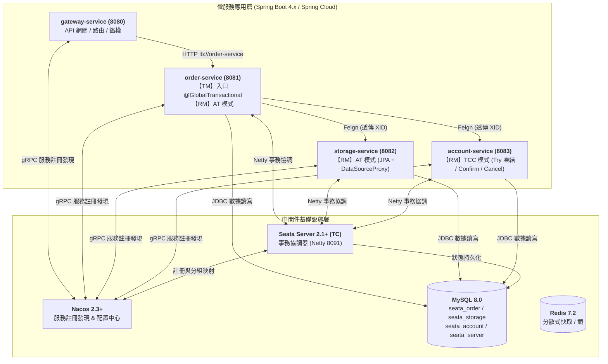

# Apache Seata 分散式事務架構全景與實戰手冊

> 本文件庫為企業級微服務系統架構設計與落地提供完整的 **Apache Seata** 技術指南，包含核心架構、四種事務模式原理、底層機制解密、高可用叢集規劃、Spring Boot 4.1.0 + JPA 實戰微服務設計架構、中間件介接規格與 Docker Compose 一鍵部署腳本。

---

## 目錄導引

1. [01. Seata 架構總覽與核心機制](file:///d:/桌面/MonoRepository/seata-architecture/docs/seata/01-architecture-overview.md)
   - 微服務分散式事務痛點與背景
   - TC (事務協調器)、TM (事務管理器)、RM (資源管理器) 三大核心組件職責
   - 全局事務 XID 的產生與跨 RPC 鏈路傳播

2. [02. 四大事務模式詳解 (AT, TCC, Saga, XA)](file:///d:/桌面/MonoRepository/seata-architecture/docs/seata/02-transaction-modes.md)
   - AT, TCC, Saga, XA 模式全維度對比與選型矩陣
   - 各模式生命週期循序圖與狀態機運作流程

3. [03. AT 模式核心機制深度解構](file:///d:/桌面/MonoRepository/seata-architecture/docs/seata/03-at-mode-deep-dive.md)
   - SQL 解析與 Before / After Image 鏡像截取機制
   - Undo Log 數據格式與反向補償演算法
   - 全局行鎖 (Global Lock) 競爭機制與防髒寫 (Dirty Write) 審計
   - 讀已提交 (Read Committed) 隔離級別防護實踐

4. [04. TCC 模式架構與三大異常設計](file:///d:/桌面/MonoRepository/seata-architecture/docs/seata/04-tcc-design-patterns.md)
   - TCC 兩階段預留模型
   - 空回滾 (Empty Rollback) 的成因與攔截
   - 業務懸掛 (Suspension) 的防護機制
   - 冪等性 (Idempotency) 控制表設計

5. [05. 生產環境部署與高可用架構 (HA)](file:///d:/桌面/MonoRepository/seata-architecture/docs/seata/05-production-deployment-ha.md)
   - TC 叢集部署拓撲與負載均衡架構
   - 儲存模式對比：DB / Redis / Raft 模式選型
   - 事務分組 (Transaction Service Group) 多機房容災切換
   - 生產環境 `application.yml` 配置範本

6. [06. 實戰整合手冊 (Spring Cloud Alibaba & MySQL)](file:///d:/桌面/MonoRepository/seata-architecture/docs/seata/06-integration-guide.md)
   - Maven 依賴與版本對齊
   - `@GlobalTransactional` 訂單下單業務完整代碼
   - 生產最佳實踐與高頻避坑指南

7. [07. Spring Boot 4.1.0 + JPA 微服務落地設計文件](file:///d:/桌面/MonoRepository/seata-architecture/docs/seata/07-spring-boot-jpa-seata-design.md)
   - 現代化技術棧：Spring Boot 4.1.0、Jakarta Persistence (JPA 3.2 / Hibernate 7.x)、Java 21+
   - **AT + TCC 混合模式落地矩陣**：庫存（AT 模式）與錢包（TCC 預留/防懸掛/防空回滾）
   - Spring Data JPA 一級快取與延遲 Flush 與 Seata DataSourceProxy 截獲技術衝突解決
   - 全鏈路交易與異常回滾循序圖、核心 Java 代碼與 `application.yml`

8. [08. 微服務數量規格、中間件選型與全鏈路介接架構文件](file:///d:/桌面/MonoRepository/seata-architecture/docs/seata/08-microservices-topology-and-middleware-integration.md) **[NEW]**
   - **4 個微服務 + 1 個基礎模組**：`gateway-service`, `order-service`, `storage-service`, `account-service`, `shared-module`
   - **4 大中間件矩陣與通訊協議**：Nacos (gRPC), Seata TC (Netty RPC), MySQL (JDBC Proxy), Redis
   - 服務間 OpenFeign 呼叫、HTTP Header `TX_XID` 自動注入傳播機制
   - 完整服務間 API 介面規格書 (API Contract) 與 Docker Compose 部署導引

9. **基礎設施與 SQL 結構腳本**：
   - 資料庫腳本使用說明手冊：[scripts/sql/README.md](file:///d:/桌面/MonoRepository/seata-architecture/scripts/sql/README.md)
   - 一鍵式容器化編排：[docker-compose.yml](file:///d:/桌面/MonoRepository/seata-architecture/docker-compose.yml)
   - 資料庫多庫全量初始化腳本：[00_init_databases.sql](file:///d:/桌面/MonoRepository/seata-architecture/scripts/sql/00_init_databases.sql)
   - TC 伺服器 DB 儲存表結構：[seata_server_db.sql](file:///d:/桌面/MonoRepository/seata-architecture/scripts/sql/seata_server_db.sql)
   - 業務庫 AT 模式復原日誌模板：[undo_log.sql](file:///d:/桌面/MonoRepository/seata-architecture/scripts/sql/undo_log.sql)

10. **實戰使用與驗證手冊**：
    - [Seata 微服務實戰使用與端到端驗證指南](file:///d:/桌面/MonoRepository/seata-architecture/docs/guide/README.md)
    - [Seata 全鏈路端到端 (E2E) 實戰測試指南 (時序流程 / API 契約 / 資料庫驗證)](file:///d:/桌面/MonoRepository/seata-architecture/docs/guide/03-end-to-end-verification-guide.md) **[NEW]**
    - [shared-module 跨專案引入指南 (本地開發 vs 正式生產環境)](file:///d:/桌面/MonoRepository/seata-architecture/docs/guide/02-shared-module-dependency-guide.md)

---

## 核心架構全景圖

