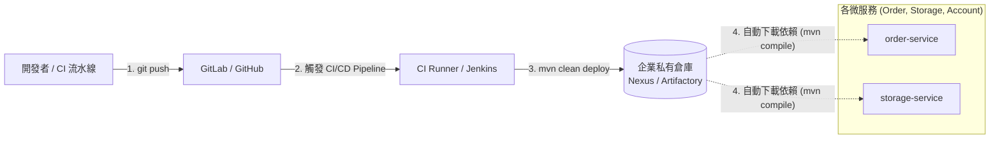

# shared-module 跨專案引入指南 (本地開發 vs 正式生產環境)

> 本文件專門解答：**「為什麼 IDE 裡的 `shared-module` 會標紅報錯？」**，以及提供在**本地開發 (Local Development)** 與 **正式生產環境 (Production / CI/CD)** 下引入與維護公共模組的完整標準作業程序 (SOP)。

---

## 目錄

- [一、 為什麼 IDEA 會標紅？(問題根本原因分析)](#一-為什麼-idea-會標紅問題根本原因分析)
- [二、 本地開發環境 (Local Dev) 引入與消紅指南](#二-本地開發環境-local-dev-引入與消紅指南)
  - [方案 A：同一個 Mono-Repo 內一鍵消紅 (最快最常用)](#方案-a同一個-mono-repo-內一鍵消紅-最快最常用)
  - [方案 B：拆分成不同資料夾或獨立 Git 專案 (Multi-Repo)](#方案-b拆分成不同資料夾或獨立-git-專案-multi-repo)
- [三、 正式環境 (Production / CI/CD) 企業級引入規範](#三-正式環境-production--cicd-企業級引入規範)
  - [流程 1：架構總覽 (Nexus / Artifactory 私有倉庫)](#流程-1架構總覽-nexus--artifactory-私有倉庫)
  - [流程 2：在 shared-module 的 pom.xml 配置發布倉庫](#流程-2在-shared-module-的-pomxml-配置發布倉庫)
  - [流程 3：在本地與 CI/CD 的 settings.xml 配置私服憑證](#流程-3在-本地與-cicd-的-settingsxml-配置私服憑證)
  - [流程 4：CI/CD 流水線發布與各微服務拉取](#流程-4cicd-流水線發布與各微服務拉取)
- [四、 生產環境 Dockerfile 構建避坑指南](#四-生產環境-dockerfile-構建避坑指南)

---

## 一、 為什麼 IDEA 會標紅？(問題根本原因分析)

您的 IDE (如 IntelliJ IDEA / VS Code) 中出現紅色波浪線：

```xml
<parent>
    <groupId>com.seata.demo</groupId>
    <artifactId>seata-architecture-demo</artifactId>
    <version>1.0.0-SNAPSHOT</version> <!-- 標紅 -->
</parent>

<dependencies>
    <dependency>
        <groupId>com.seata.demo</groupId>
        <artifactId>shared-module</artifactId> <!-- 標紅 -->
    </dependency>
</dependencies>
```

### 根本原因：
1. **本地 Maven 快取 (`~/.m2/repository`) 尚未存在產物**：
   Maven 尋找依賴的優先級是先看本機快取目錄 `~/.m2/repository/com/seata/demo/shared-module/`。在全新的專案尚未執行 `mvn install` 之前，這個目錄是**不存在**的，因此 IDE 判定為「找不到依賴 (Cannot resolve symbol)」。
2. **IDE 尚未重新索引 Maven 依賴樹 (Sync / Reload)**：
   有時雖然目錄已有檔案，但 IDEA 的 Maven 外掛尚未掃描更新。

---

## 二、 本地開發環境 (Local Dev) 引入與消紅指南

### 方案 A：直接使用 IntelliJ IDEA 圖形介面（最推薦，完全不需要在終端機輸入指令）

如果您在終端機輸入 `mvn` 出現 `'mvn' 不是內部或外部命令`，代表 Windows 系統環境變數尚未設定 Maven 的 `PATH`。
**在 IntelliJ IDEA 中您完全不需要設定環境變數，直接透過 IDEA 內建的 Maven 面板操作即可：**

1. **開啟 Maven 面板**：
   - 看向 IDEA 視窗**最右側邊欄**，點擊 **「Maven」** 標籤（若沒看到，可從頂部選單 `View -> Tool Windows -> Maven` 開啟）。
2. **執行 Root 的 install**：
   - 展開樹狀選單：`seata-architecture-demo (root)` -> `Lifecycle`。
   - 對著 **`install`**（建議可先雙擊 `clean`，再雙擊 `install`）**滑鼠左鍵點擊兩下 (Double Click)**。
   - *(或者展開 `shared-module` -> `Lifecycle` -> 雙擊 `install`)*。
3. **重新載入 Maven 依賴**：
   - 待下方進度條執行完畢後，點擊 Maven 面板左上角的 **「Reload All Maven Projects」**（雙箭頭圓形重新整理按鈕，或快捷鍵 `Ctrl + Shift + O`）。
   - 此時 POM 檔案中的紅色波浪線立即消失！

---

### 方案 B：在終端機使用本機 Maven 完整路徑或加入 PATH

若您習慣使用 PowerShell / CMD 終端機：

#### 方式 1：直接使用您本機已存在的 Maven 完整路徑
在專案根目錄開啟 PowerShell，直接執行：
```powershell
& "C:\Users\nick5\.m2\wrapper\dists\apache-maven-3.9.9-bin\33b4b2b4\apache-maven-3.9.9\bin\mvn.cmd" clean install -pl shared-module -am -DskipTests
```

#### 方式 2：將 Maven 加入 Windows 系統環境變數 (PATH)
1. 按 `Win + R` 輸入 `sysdm.cpl` 並按 Enter，切換至「進階」分頁 -> 點擊「環境變數」。
2. 在下方「系統變數」中找到 `Path`，點擊「編輯」->「新增」。
3. 貼上 Maven 的 `bin` 目錄路徑：
   `C:\Users\nick5\.m2\wrapper\dists\apache-maven-3.9.9-bin\33b4b2b4\apache-maven-3.9.9\bin`
4. 點擊確定儲存後，**關閉並重新打開 PowerShell / 終端機**，輸入 `mvn -v` 即可成功識別指令。

---

### 方案 C：拆分成不同資料夾或獨立 Git 專案 (Multi-Repo 本地聯調)

若未來團隊決定將 `shared-module` 抽成獨立的 Git Repository（例如 `git clone https://.../shared-module.git`）：

#### 步驟 1：在 `shared-module` 專案中執行本地安裝
每次修改 `shared-module` 的代碼後，在 `shared-module` 的專案目錄下執行：
```powershell
mvn clean install -DskipTests
```
這會將編譯後的 `shared-module-1.0.0-SNAPSHOT.jar` 寫入您本機電腦的 `C:\Users\<您的使用者名稱>\.m2\repository\` 中。

#### 步驟 2：在獨立的業務微服務 (`order-service` 等) 引入
在業務微服務的 `pom.xml` 中，直接宣告依賴即可被本機 Maven 正確讀取：
```xml
<dependency>
    <groupId>com.seata.demo</groupId>
    <artifactId>shared-module</artifactId>
    <version>1.0.0-SNAPSHOT</version>
</dependency>
```

---

## 三、 正式環境 (Production / CI/CD) 企業級引入規範

在企業正式環境或跨多人團隊開發中，**絕對不能要求工程師各自在本機 manual install，也不應依賴本機快取**。
標準做法是搭建**企業私有 Maven 倉庫**（如 Sonatype Nexus OSS、JFrog Artifactory、GitLab Package Registry 或 AWS CodeArtifact）。



---

### 流程 1：在 `shared-module/pom.xml` 配置發布倉庫

在 `shared-module/pom.xml`（或根 `pom.xml`）加入 `<distributionManagement>`，告知 Maven 發布目標：

```xml
<project>
    <!-- ... 省略其他標籤 ... -->

    <distributionManagement>
        <!-- 正式發布版倉庫 (Release) -->
        <repository>
            <id>nexus-releases</id>
            <name>Corporate Nexus Release Repository</name>
            <url>https://nexus.yourcompany.com/repository/maven-releases/</url>
        </repository>
        <!-- 快照版本倉庫 (SNAPSHOT，開發中頻繁更新版本) -->
        <snapshotRepository>
            <id>nexus-snapshots</id>
            <name>Corporate Nexus Snapshot Repository</name>
            <url>https://nexus.yourcompany.com/repository/maven-snapshots/</url>
        </snapshotRepository>
    </distributionManagement>
</project>
```

---

### 流程 2：在 `settings.xml` 配置私服認證帳密

Maven 發布與下載私有包需要身份認證。在 `C:\Users\<用戶名>\.m2\settings.xml`（本地）或 CI/CD Runner 的環境變量中配置 `<servers>`：

```xml
<settings xmlns="http://maven.apache.org/SETTINGS/1.0.0">
    <servers>
        <!-- 對應 pom.xml 中的 <id>nexus-releases</id> -->
        <server>
            <id>nexus-releases</id>
            <username>${env.NEXUS_USER}</username>
            <password>${env.NEXUS_PASSWORD}</password>
        </server>
        <!-- 對應 pom.xml 中的 <id>nexus-snapshots</id> -->
        <server>
            <id>nexus-snapshots</id>
            <username>${env.NEXUS_USER}</username>
            <password>${env.NEXUS_PASSWORD}</password>
        </server>
    </servers>

    <!-- 配置鏡像或倉庫源，讓微服務能自動下載私服依賴 -->
    <profiles>
        <profile>
            <id>nexus-profile</id>
            <repositories>
                <repository>
                    <id>nexus-central</id>
                    <url>https://nexus.yourcompany.com/repository/maven-public/</url>
                    <releases><enabled>true</enabled></releases>
                    <snapshots><enabled>true</enabled></snapshots>
                </repository>
            </repositories>
        </profile>
    </profiles>

    <activeProfiles>
        <activeProfile>nexus-profile</activeProfile>
    </activeProfiles>
</settings>
```

---

### 流程 3：CI/CD 流水線發布 (`mvn deploy`)

#### GitLab CI 範例 (`.gitlab-ci.yml`)：
```yaml
stages:
  - publish

publish-shared-module:
  stage: publish
  image: maven:3.9-eclipse-temurin-21
  only:
    changes:
      - shared-module/**/*
  script:
    - mvn clean deploy -pl shared-module -DskipTests -s settings-ci.xml
```

#### GitHub Actions 範例 (`.github/workflows/publish.yml`)：
```yaml
name: Publish Shared Module

on:
  push:
    paths:
      - 'shared-module/**'
    branches:
      - main

jobs:
  publish:
    runs-on: ubuntu-latest
    steps:
      - uses: actions/checkout@v4
      - name: Set up JDK 21
        uses: actions/setup-java@v4
        with:
          java-version: '21'
          distribution: 'temurin'
          server-id: nexus-snapshots
          server-username: ${{ secrets.NEXUS_USER }}
          server-password: ${{ secrets.NEXUS_PASSWORD }}
      - name: Deploy to Nexus
        run: mvn clean deploy -pl shared-module -DskipTests
```

---

### 流程 4：其他微服務如何引入私服版本

發布後，其他微服務（即使在其他團隊、其他電腦或全新伺服器）的 `pom.xml` 只需要指定版本號：

```xml
<dependencies>
    <!-- 從企業私服自動拉取 -->
    <dependency>
        <groupId>com.seata.demo</groupId>
        <artifactId>shared-module</artifactId>
        <version>1.0.0-SNAPSHOT</version>
    </dependency>
</dependencies>
```

> 💡 **版本規範建議**：
> * **平時功能開發中**：使用 `1.0.0-SNAPSHOT`，每次 CI 發布後，其他服務 `mvn compile -U`（Force Update）會自動拉取最新快照。
> * **正式上線生產時**：將版本號改為 `1.0.0` 或 `1.0.0.RELEASE`，正式 Release 版本發布後不可覆蓋，保障線上建置的 100% 確定性。

---

## 四、 生產環境 Dockerfile 構建避坑指南

在生產環境構建各微服務的 Docker 映像檔時，經常會遇到：**「本機明明跑得動，但 Dockerfile 執行 `mvn package` 時報找不到 `shared-module`」**！

### 原因：
Dockerfile 預設只複製了 `order-service` 單一目錄，容器內部的隔離環境沒有 `shared-module`，也沒有您的本機快取。

### 正確做法：採用多階段構建 (Multi-stage Build)
在專案根目錄執行 Docker build，同時將 `shared-module` 複製進編譯階段：

```dockerfile
# 階段 1：Maven 編譯打包環境
FROM maven:3.9-eclipse-temurin-21 AS builder
WORKDIR /workspace

# 1. 先複製父 POM 與 shared-module 優先編譯
COPY pom.xml .
COPY shared-module/ shared-module/
RUN mvn clean install -pl shared-module -DskipTests

# 2. 複製目標微服務並打包
COPY order-service/ order-service/
RUN mvn clean package -pl order-service -DskipTests

# 階段 2：極簡運行環境 (縮小映像檔體積)
FROM eclipse-temurin:21-jre-alpine
WORKDIR /app
COPY --from=builder /workspace/order-service/target/order-service-*.jar app.jar
EXPOSE 8081
ENTRYPOINT ["java", "-jar", "app.jar"]
```

---

## 五、 總結回顧

| 情境 | 核心操作步驟 |
| :--- | :--- |
| **本地開發（當前專案標紅）** | 根目錄執行 `mvn clean install -pl shared-module -am -DskipTests` $\to$ IDEA 點擊 **Reload All Maven Projects**。 |
| **本地多專案聯調** | 在 `shared-module` 執行 `mvn clean install` 安裝到本機 `~/.m2`。 |
| **正式生產 / CI/CD** | 在 `pom.xml` 配置 `<distributionManagement>`，由 CI/CD 執行 `mvn deploy` 發布至企業私服 (Nexus/GitLab)，微服務自動聯網拉取。 |
| **Docker 容器編譯** | 在 Dockerfile 第一階段先 `mvn install -pl shared-module`，再打包業務微服務。 |
