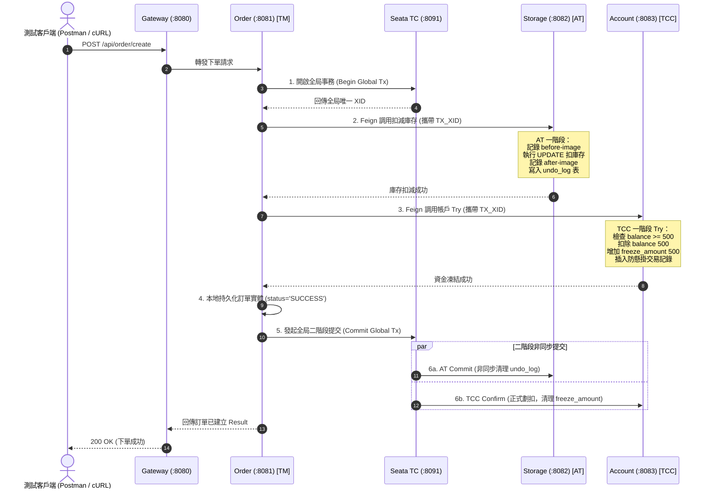
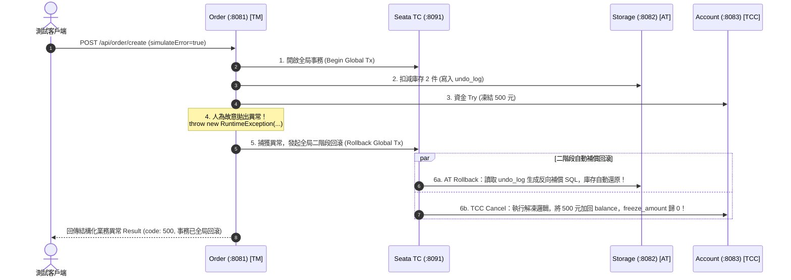

# Seata 分散式事務全鏈路端到端 (E2E) 實戰測試指南

> 本文件為本微服務架構的**核心測試手冊**，專門提供「下單 - 扣減庫存 (AT) - 帳戶劃扣 (TCC)」全鏈路的實戰驗證指南。
> 涵蓋**業務調度流程**、**API Request / Response 完整 Payload**、**資料庫前後狀態對比 SQL** 以及 **Seata TC 內部狀態表驗證**。

---

## 目錄

- [一、 測試環境與數據基準](#一-測試環境與數據基準)
- [二、 測試情境 1：正常下單流程 (二階段提交 Two-Phase Commit)](#二-測試情境-1正常下單流程-二階段提交-two-phase-commit)
  - [1. 業務架構與時序流程](#1-業務架構與時序流程)
  - [2. API 呼叫規格 (Request & Response)](#2-api-呼叫規格-request--response)
  - [3. 即時業務 API 驗證 (推薦：無需操作資料庫)](#3-即時業務-api-驗證-推薦無需操作資料庫)
  - [4. 資料庫前後數據驗證 (SQL 驗證)](#4-資料庫前後數據驗證-sql-驗證)
- [三、 測試情境 2：人為模擬異常 (二階段分散式回滾 Two-Phase Rollback)](#三-測試情境-2人為模擬異常-二階段分散式回滾-two-phase-rollback)
  - [1. 業務架構與時序流程](#1-業務架構與時序流程-1)
  - [2. API 呼叫規格 (Request & Response)](#2-api-呼叫規格-request--response-1)
  - [3. 即時業務 API 自動補償驗證 (推薦：無需操作資料庫)](#3-即時業務-api-自動補償驗證-推薦無需操作資料庫)
  - [4. 自動補償驗證 (關鍵檢查點 - SQL)](#4-自動補償驗證-關鍵檢查點---sql)
- [四、 測試情境 3：邊界防禦測試 (庫存不足與餘額不足)](#四-測試情境-3邊界防禦測試-庫存不足與餘額不足)
  - [情境 3-1：庫存不足防禦 (Storage Insufficient)](#情境-3-1庫存不足防禦-storage-insufficient)
  - [情境 3-2：餘額不足防禦 (Balance Insufficient)](#情境-3-2餘額不足防禦-balance-insufficient)
- [五、 各微服務業務查詢與內部 API 規格參照 (Business Query & RPC)](#五-各微服務業務查詢與內部-api-規格參照-business-query--rpc)
  - [1. 跨微服務業務查詢 API 總覽 (Business Query APIs)](#1-跨微服務業務查詢-api-總覽-business-query-apis)
  - [2. 庫存微服務內部 RPC (Storage Service)](#2-庫存微服務內部-rpc-storage-service)
  - [3. 帳戶微服務內部 RPC (Account Service - TCC)](#3-帳戶微服務內部-rpc-account-service---tcc)
- [六、 快捷測試工具腳本 (cURL & PowerShell)](#六-快捷測試工具腳本-curl--powershell)
  - [1. 執行「情境 1：正常下單提交」](#1-執行情境-1正常下單提交)
  - [2. 執行「情境 2：人為異常全鏈路回滾」](#2-執行情境-2人為異常全鏈路回滾)
  - [3. 一鍵跨微服務業務查詢 (驗證業務即時狀態)](#3-一鍵跨微服務業務查詢-驗證業務即時狀態)
  - [4. 一鍵查詢目前數據庫狀態 (SQL 底層比對)](#4-一鍵查詢目前數據庫狀態-sql-底層比對)

---

## 一、 測試環境與數據基準

### 1. 存取入口資訊

| 組件名稱 | 監聽端點 | 說明 |
| :--- | :--- | :--- |
| **API 網關 (Gateway)** | `http://localhost:8080` | 建議統一訪問入口，自動負載均衡 |
| **訂單微服務 (Order)** | `http://localhost:8081` | 事務發起者 (TM + AT RM) |
| **庫存微服務 (Storage)** | `http://localhost:8082` | 庫存扣減 (AT RM) |
| **帳戶微服務 (Account)** | `http://localhost:8083` | 資金劃扣 (TCC RM) |
| **MySQL 資料庫** | `localhost:3307` | 帳密：`root` / `root_password` |
| **Nacos 控制台** | `http://localhost:8848/nacos` | 帳密：`nacos` / `nacos` |
| **Seata TC 控制台** | `http://localhost:7091` | 帳密：`seata` / `seata` |

### 2. 初始測試數據基準 (Baseline Data)

由 `00_init_databases.sql` 預設寫入的數據：
* **商品數據 (`seata_storage.t_storage`)**：
  * 商品 ID：`20001`
  * 總庫存 (`total`)：`100` 件
  * 已用庫存 (`used`)：`0` 件
  * 剩餘可用 (`residue`)：`100` 件
* **帳戶數據 (`seata_account.t_account`)**：
  * 用戶 ID：`10001`
  * 可用餘額 (`balance`)：`10,000.00` 元
  * 凍結金額 (`freeze_amount`)：`0.00` 元

---

## 二、 測試情境 1：正常下單流程 (二階段提交 Two-Phase Commit)

### 1. 業務架構與時序流程

此情境驗證下單交易成功時，Seata 協調完成 AT 模式與 TCC 模式的二階段提交：



---

### 2. API 呼叫規格 (Request & Response)

#### 請求規格 (Request)
* **Method**：`POST`
* **URL**：`http://localhost:8080/api/order/create`（或直連 `http://localhost:8081/api/order/create`）
* **Headers**：`Content-Type: application/json`
* **Payload (JSON)**：
  ```json
  {
    "userId": 10001,
    "productId": 20001,
    "count": 2,
    "payAmount": 500.00,
    "simulateError": false
  }
  ```

| 欄位名稱 | 型別 | 必填 | 範例值 | 業務說明 |
| :--- | :--- | :--- | :--- | :--- |
| `userId` | Long | 是 | `10001` | 下單用戶 ID |
| `productId` | Long | 是 | `20001` | 購買商品 ID |
| `count` | Integer | 是 | `2` | 購買數量 |
| `payAmount` | BigDecimal | 是 | `500.00` | 訂單總支付金額 |
| `simulateError`| Boolean | 否 | `false` | 是否模擬異常（`false` 為正常流程） |

#### 回應規格 (Response)
* **HTTP Status**：`200 OK`
* **Payload (JSON)**：
  ```json
  {
    "code": 200,
    "message": "SUCCESS",
    "data": {
      "orderId": 17322384729104,
      "userId": 10001,
      "productId": 20001,
      "count": 2,
      "amount": 500.00,
      "status": "SUCCESS"
    }
  }
  ```

---

### 3. 即時業務 API 驗證 (推薦：無需操作資料庫)

完成下單後，您**無需登入資料庫**，即可透過各微服務提供的業務查詢 API 驗證全鏈路狀態：

#### 步驟 1：查詢訂單詳情 (Order Service)
* **Method**：`GET`
* **URL**：`http://localhost:8080/api/order/{orderId}`（請替換為下單回傳之實際 `orderId`，例如 `http://localhost:8080/api/order/17322384729104`）
* **預期回應**：
  ```json
  {
    "code": 200,
    "message": "SUCCESS",
    "data": {
      "orderId": 17322384729104,
      "userId": 10001,
      "productId": 20001,
      "count": 2,
      "amount": 500.00,
      "status": "SUCCESS"
    }
  }
  ```
  > 訂單持久化成功，狀態為 `SUCCESS`。

#### 步驟 2：查詢商品即時庫存 (Storage Service)
* **Method**：`GET`
* **URL**：`http://localhost:8080/api/storage/20001`
* **預期回應**：
  ```json
  {
    "code": 200,
    "message": "SUCCESS",
    "data": {
      "productId": 20001,
      "total": 100,
      "used": 2,
      "residue": 98
    }
  }
  ```
  > 剩餘庫存 `residue` 成功由 100 扣減為 98，已用庫存 `used` 增加為 2。

#### 步驟 3：查詢用戶帳戶資金 (Account Service)
* **Method**：`GET`
* **URL**：`http://localhost:8080/api/account/10001`
* **預期回應**：
  ```json
  {
    "code": 200,
    "message": "SUCCESS",
    "data": {
      "userId": 10001,
      "balance": 9500.00,
      "freezeAmount": 0.00,
      "totalAmount": 9500.00
    }
  }
  ```
  > 可用餘額 `balance` 由 10000.00 劃扣為 9500.00，二階段 Confirm 完成後凍結金額 `freezeAmount` 歸 0。

---

### 4. 資料庫前後數據驗證 (SQL 驗證)

執行完請求後，請連線 MySQL (`localhost:3307`) 執行以下驗證：

```sql
-- 1. 驗證訂單庫：產生一筆 status 為 SUCCESS 的訂單
SELECT id, user_id, product_id, count, amount, status FROM seata_order.t_order ORDER BY id DESC LIMIT 1;
```
> **預期結果**：存在訂單資料，`status = 'SUCCESS'`, `amount = 500.00`, `count = 2`。

```sql
-- 2. 驗證庫存庫：剩餘庫存減少 2 件，已用庫存增加 2 件
SELECT product_id, total, used, residue FROM seata_storage.t_storage WHERE product_id = 20001;
```
> **預期結果**：`total = 100`, `used = 2`, `residue = 98`。

```sql
-- 3. 驗證帳戶庫：餘額扣除 500，凍結金額歸 0 (TCC Confirm 階段已劃扣)
SELECT user_id, balance, freeze_amount FROM seata_account.t_account WHERE user_id = 10001;
```
> **預期結果**：`balance = 9500.00`, `freeze_amount = 0.00`。

```sql
-- 4. 驗證 TCC 事務控制表記錄
SELECT tx_xid, action_name, user_id, amount, status FROM seata_account.t_tcc_transaction_record ORDER BY id DESC LIMIT 1;
```
> **預期結果**：`status = 'CONFIRMED'`。

```sql
-- 5. 驗證 AT 復原日誌：二階段成功提交後，undo_log 已被非同步清理
SELECT * FROM seata_storage.undo_log;
```
> **預期結果**：查詢結果為 0 筆（已被 Seata 自動清除）。

---

## 三、 測試情境 2：人為模擬異常 (二階段分散式回滾 Two-Phase Rollback)

### 1. 業務架構與時序流程

這是驗證 Seata 分散式事務核心價值的關鍵場景。
當前端傳入 `"simulateError": true` 時，訂單服務在**呼叫完庫存扣減與帳戶 Try 之後，故意在本地拋出運行時異常**。



---

### 2. API 呼叫規格 (Request & Response)

#### 請求規格 (Request)
* **Method**：`POST`
* **URL**：`http://localhost:8080/api/order/create`
* **Headers**：`Content-Type: application/json`
* **Payload (JSON)**：
  ```json
  {
    "userId": 10001,
    "productId": 20001,
    "count": 2,
    "payAmount": 500.00,
    "simulateError": true
  }
  ```

#### 回應規格 (Response)
* **HTTP Status**：`200 OK`（由全局例外處理器 `GlobalExceptionHandler` 統一攔截並封裝，避免未捕獲 500 造成連線中斷或 Swagger 跨域問題）
* **Payload (JSON)**：
  ```json
  {
    "code": 500,
    "message": "【模擬業務異常】觸發 Seata 全局分散式事務回滾！庫存將自動恢復，帳戶凍結金額將自動解凍！",
    "data": null
  }
  ```
> 💡 **機制說明**：異常在 Service 層拋出時，已順利觸發 Seata `@GlobalTransactional` 攔截器進行全鏈路二階段回滾；隨後在表現層由 `@RestControllerAdvice` 攔截並轉換為標準 `Result.failure(500, ...)` 回應。

---

### 3. 即時業務 API 自動補償驗證 (推薦：無需操作資料庫)

發送 `simulateError: true` 請求後，透過各微服務的業務查詢 API 即可即時驗證分散式事務的自動補償效果：

#### 步驟 1：查詢商品即時庫存 (驗證 AT 自動回滾補償)
* **Method**：`GET`
* **URL**：`http://localhost:8080/api/storage/20001`
* **預期回應**：
  ```json
  {
    "code": 200,
    "message": "SUCCESS",
    "data": {
      "productId": 20001,
      "total": 100,
      "used": 0,
      "residue": 100
    }
  }
  ```
  > 庫存依然保持 `residue = 100`，`used = 0`！表示 Seata AT 資源管理器已自動解析 `undo_log` 生成逆向 SQL 並完成補償恢復。

#### 步驟 2：查詢用戶帳戶資金 (驗證 TCC Cancel 自動解凍)
* **Method**：`GET`
* **URL**：`http://localhost:8080/api/account/10001`
* **預期回應**：
  ```json
  {
    "code": 200,
    "message": "SUCCESS",
    "data": {
      "userId": 10001,
      "balance": 10000.00,
      "freezeAmount": 0.00,
      "totalAmount": 10000.00
    }
  }
  ```
  > 用戶可用餘額依然為 `balance = 10000.00`，`freezeAmount = 0.00`！表示 Seata TC 已自動協調呼叫 TCC Cancel 分支，將 Try 凍結金額全數退回。

---

### 4. 自動補償驗證 (關鍵檢查點 - SQL)

請在發送異常請求後，立即查詢 MySQL (`localhost:3307`) 驗證神奇的自動數據補償：

```sql
-- 1. 檢查庫存庫 (AT 模式自動補償)
SELECT product_id, total, used, residue FROM seata_storage.t_storage WHERE product_id = 20001;
```
> **預期結果**：
> `residue` **依然保持 100 件**（庫存已被自動還原！），`used` 依然為 0。
> 👉 **背後機制**：Seata AT 資源管理器解析該 XID 對應的 `undo_log`，自動生成逆向 `UPDATE t_storage SET residue = residue + 2, used = used - 2` 補償執行！

```sql
-- 2. 檢查帳戶庫 (TCC 模式 Cancel 解凍)
SELECT user_id, balance, freeze_amount FROM seata_account.t_account WHERE user_id = 10001;
```
> **預期結果**：
> `balance` **依然保持 10000.00 元**，`freeze_amount` **依然為 0.00 元**。
> 👉 **背後機制**：Seata TC 自動遠端呼叫 `AccountTccAction.cancel()`，將 Try 階段凍結的 500 元安全退回可用餘額！

```sql
-- 3. 檢查 TCC 交易記錄狀態
SELECT xid, branch_id, user_id, status, freeze_amount FROM seata_account.t_tcc_transaction_record ORDER BY gmt_create DESC LIMIT 1;
```
> **預期結果**：該筆記錄的 `status = 'CANCELED'`，有效防止空回滾與重複防懸掛。

```sql
-- 4. 檢查訂單庫
SELECT * FROM seata_order.t_order WHERE count = 2 AND amount = 500.00;
```
> **預期結果**：訂單庫內**沒有殘留該筆失敗的髒資料**（本地 Spring Data JPA 事務已完全回滾）。

---

## 四、 測試情境 3：邊界防禦測試 (庫存不足與餘額不足)

### 情境 3-1：庫存不足防禦 (Storage Insufficient)

當購買數量超過庫存餘量時，庫存微服務在領域層拋出 `StockInsufficientException` 中斷交易，並由全域例外處理器回傳明確的業務錯誤：

#### 1. 發送超額購買請求
```json
{
  "userId": 10001,
  "productId": 20001,
  "count": 9999,
  "payAmount": 500.00,
  "simulateError": false
}
```

#### 2. 預期行為
* **HTTP 回應**：`200 OK`，業務狀態碼 `code: 400`
* **Payload (JSON)**：
  ```json
  {
    "code": 400,
    "message": "庫存扣減失敗: 商品 [ID: 20001] 可用庫存不足，請求扣減: 9999, 目前剩餘: 100",
    "data": null
  }
  ```
* **數據驗證**：
  * 庫存庫 `t_storage` 未發生任何扣減，`residue` 維持 100。
  * 帳戶庫 `t_account` 連 Try 階段都未曾執行，餘額維持 10000.00。
  * 訂單庫 `t_order` 無資料產生。

---

### 情境 3-2：餘額不足防禦 (Balance Insufficient)

當購買商品時庫存充足，但用戶錢包餘額不足以支付總價：

#### 1. 發送超額金額請求
```json
{
  "userId": 10001,
  "productId": 20001,
  "count": 1,
  "payAmount": 9999999.00,
  "simulateError": false
}
```

#### 2. 預期行為
* **HTTP 回應**：`200 OK`，業務狀態碼 `code: 400`
* **Payload (JSON)**：
  ```json
  {
    "code": 400,
    "message": "帳戶金額凍結失敗: 用戶 [ID: 10001] 可用餘額不足，請求凍結/扣減: 9999999.00, 目前可用餘額: 10000.00",
    "data": null
  }
  ```
* **執行鏈路與自動補償**：
  1. 庫存微服務先成功執行 AT 一階段扣減 1 件（寫入 `undo_log`）。
  2. 帳戶微服務執行 Try 發現 `balance < 9999999.00`，由 `GlobalExceptionHandler` 捕獲並回應業務錯誤 400。
  3. 訂單服務感知下游帳戶凍結失敗，拋出例外觸發全局 `@GlobalTransactional` 回滾。
  4. Seata TC 驅動庫存服務執行 AT 回滾，**剛被扣減的 1 件庫存立即自動還原為 100 件**！
* **數據驗證**：
  * 庫存 `residue` 保持 100 件，不留任何扣除痕跡。
  * 帳戶餘額保持 10000.00 元。
  * 訂單庫無此訂單。

---

## 五、 各微服務業務查詢與內部 API 規格參照 (Business Query & RPC)

微服務之間透過 OpenFeign 進行 RPC 調用，同時各微服務對外開放具備商業語意的查詢 API，供業務展示或端到端測試驗證：

### 1. 跨微服務業務查詢 API 總覽 (Business Query APIs)

#### (1) 庫存微服務 - 依商品 ID 查詢即時庫存
* **Method**：`GET`
* **URL**：`http://localhost:8080/api/storage/{productId}`（直連：`http://localhost:8082/api/storage/{productId}`）
* **Path Variable**：`productId` (商品 ID，例如 `20001`)
* **Response**：
  ```json
  {
    "code": 200,
    "message": "SUCCESS",
    "data": {
      "productId": 20001,
      "total": 100,
      "used": 0,
      "residue": 100
    }
  }
  ```

#### (2) 帳戶微服務 - 依用戶 ID 查詢資產總覽
* **Method**：`GET`
* **URL**：`http://localhost:8080/api/account/{userId}`（直連：`http://localhost:8083/api/account/{userId}`）
* **Path Variable**：`userId` (用戶 ID，例如 `10001`)
* **Response**：
  ```json
  {
    "code": 200,
    "message": "SUCCESS",
    "data": {
      "userId": 10001,
      "balance": 10000.00,
      "freezeAmount": 0.00,
      "totalAmount": 10000.00
    }
  }
  ```

#### (3) 訂單微服務 - 依訂單 ID 查詢訂單詳情
* **Method**：`GET`
* **URL**：`http://localhost:8080/api/order/{orderId}`（直連：`http://localhost:8081/api/order/{orderId}`）
* **Path Variable**：`orderId` (訂單 ID，例如 `17322384729104`)
* **Response**：
  ```json
  {
    "code": 200,
    "message": "SUCCESS",
    "data": {
      "orderId": 17322384729104,
      "userId": 10001,
      "productId": 20001,
      "count": 2,
      "amount": 500.00,
      "status": "SUCCESS"
    }
  }
  ```

---

### 2. 庫存微服務內部 RPC (Storage Service)

#### 扣減商品庫存 API
* **URL**：`POST /api/storage/deduct`
* **Request**：
  ```json
  {
    "productId": 20001,
    "count": 2
  }
  ```
* **Response**：
  ```json
  {
    "code": 200,
    "message": "SUCCESS",
    "data": {
      "productId": 20001,
      "deductedCount": 2,
      "status": "DEDUCTED"
    }
  }
  ```

---

### 3. 帳戶微服務內部 RPC (Account Service - TCC)

#### 預備/凍結資金 API (TCC 一階段 Try)
* **URL**：`POST /api/account/tcc/prepare`
* **Request**：
  ```json
  {
    "userId": 10001,
    "amount": 500.00
  }
  ```
* **Response**：
  ```json
  {
    "code": 200,
    "message": "SUCCESS",
    "data": {
      "userId": 10001,
      "frozenAmount": 500.00,
      "status": "PREPARED"
    }
  }
  ```

---

## 六、 快捷測試工具腳本 (cURL & PowerShell)

您可以直接複製以下一鍵指令在終端機中執行：

### 1. 執行「情境 1：正常下單提交」
```powershell
curl -X POST http://localhost:8080/api/order/create `
  -H "Content-Type: application/json" `
  -d '{\"userId\": 10001, \"productId\": 20001, \"count\": 2, \"payAmount\": 500.00, \"simulateError\": false}'
```

### 2. 執行「情境 2：人為異常全鏈路回滾」
```powershell
curl -X POST http://localhost:8080/api/order/create `
  -H "Content-Type: application/json" `
  -d '{\"userId\": 10001, \"productId\": 20001, \"count\": 2, \"payAmount\": 500.00, \"simulateError\": true}'
```

### 3. 一鍵跨微服務業務查詢 (驗證業務即時狀態)
無需登入資料庫，直接透過 HTTP 查詢最新業務狀態：
```powershell
# 1. 查詢庫存微服務即時剩餘量
curl -X GET http://localhost:8080/api/storage/20001

# 2. 查詢帳戶微服務可用餘額與凍結款項
curl -X GET http://localhost:8080/api/account/10001

# 3. 查詢指定訂單狀態 (請替換為下單回傳的實際 orderId)
curl -X GET http://localhost:8080/api/order/{orderId}
```

### 4. 一鍵查詢目前數據庫狀態 (SQL 底層比對)
在 PowerShell 中執行以下指令快速檢視當前數據：
```powershell
docker exec -it seata-mysql mysql -uroot -proot_password -e "
SELECT '--- STORAGE ---' AS '';
SELECT product_id, total, used, residue FROM seata_storage.t_storage;
SELECT '--- ACCOUNT ---' AS '';
SELECT user_id, balance, freeze_amount FROM seata_account.t_account;
SELECT '--- ORDER ---' AS '';
SELECT id, user_id, product_id, count, amount, status FROM seata_order.t_order;
"
```
