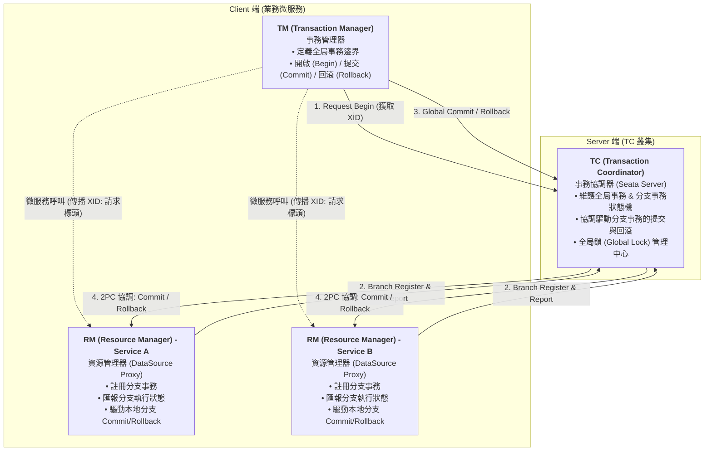

# 01. Seata 架構總覽與核心機制

## 1. 背景與核心定位

在單體架構中，多個業務操作位於同一進程，透過資料庫提供的本地事務（Local ACID Transaction）即可保證數據一致性。然而在微服務拆分（Microservices Architecture）後：
- 服務被拆分為多個獨立進程（如：訂單服務、庫存服務、帳戶服務）。
- 每個服務擁有獨立的資料庫（Database per Service）。
- 原本的本地事務轉變為跨服務、跨資料庫的**分散式事務（Distributed Transaction）**。

傳統的兩階段提交協議（XA / 2PC）存在資源鎖定時間過長、效能低落、單點故障等瓶頸。**Apache Seata**（Simple Extensible Autonomous Transaction Architecture）旨在提供高效能、對業務侵入極低（AT 模式只需一個註解）且支援多種事務模式的開源分散式事務框架。

---

## 2. 三大核心組件角色

Seata 抽象出三個關鍵組件，形成了清晰的職責邊界：



### 2.1 TC (Transaction Coordinator) - 事務協調器
- **定位**：獨立部署的伺服器叢集（Seata Server）。
- **職責**：
  - 維護全局事務和分支事務的狀態（透過 DB、Redis 或 Raft 一致性協議持久化）。
  - 全局行鎖（Global Lock）的分配與校驗中心。
  - 驅動二階段提交或回滾操作。
  - 處理超時事務、異常補償重試。

### 2.2 TM (Transaction Manager) - 事務管理器
- **定位**：嵌入在全局事務的發起方服務（通常是在調用鏈入口標記 `@GlobalTransactional` 的方法）。
- **職責**：
  - 向 TC 申請開啟全局事務，獲取全局唯一的 **XID**（Transaction ID）。
  - 將 XID 透過 RPC / HTTP 鏈路標頭傳播至下游服務。
  - 根據各微服務調用成功與否，向 TC 發起全局提交（Commit）或全局回滾（Rollback）請求。

### 2.3 RM (Resource Manager) - 資源管理器
- **定位**：嵌入在存取具體數據庫資源的業務服務中（透過 Seata 的 `DataSourceProxy` 自動包裝原生物理數據源）。
- **職責**：
  - 攔截業務 SQL，解析 SQL 生成前後鏡像（Before / After Image）與回滾日誌（Undo Log）。
  - 向 TC 註冊分支事務，申請全局鎖。
  - 匯報本地分支事務的執行結果。
  - 接收 TC 下發的一致性二階段指令，執行二階段清理或逆向回滾。

---

## 3. 全局事務 XID 與跨服務鏈路傳播

**XID (Transaction ID)** 是全局事務的唯一標識符，格式通常為：
```text
<TC_IP>:<TC_PORT>:<TRANSACTION_ID>
例如: 192.168.1.100:8091:87463529402847104
```

### XID 傳播途徑：
1. **Spring Cloud OpenFeign**：
   Seata 提供 `SeataFeignClientInterceptor`，自動將 `RootContext.getXID()` 放入 HTTP Request Header (`TX_XID`)。
2. **Dubbo / gRPC**：
   透過 RPC Filter / Metadata 攔截器，將 XID 寫入 RPC 隱式傳參（Attachment）中。
3. **下游端點接收**：
   下游服務的 Web Filter / RPC Provider 攔截請求，解析出 XID，並透過 `RootContext.bind(xid)` 綁定到當前線程的 `ThreadLocal`，供 RM 識別該操作屬於哪個全局事務。
