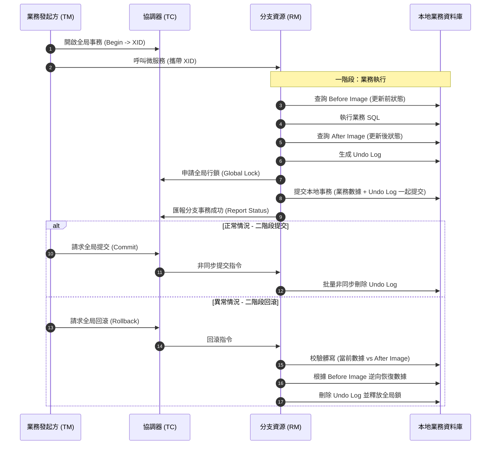
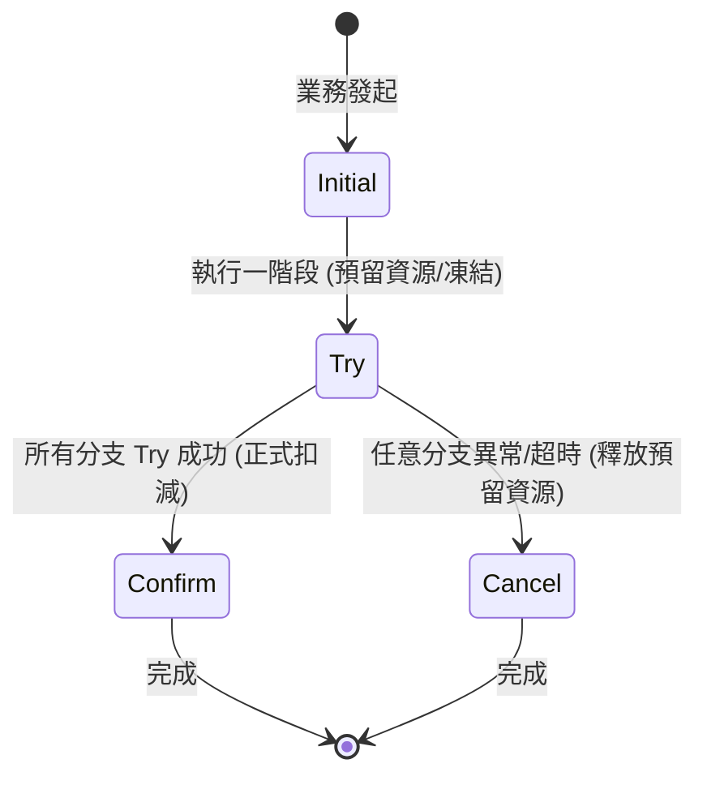

# 02. 四大事務模式詳解 (AT, TCC, Saga, XA)

Seata 支援四種事務模式，滿足不同業務一致性、效能以及系統環境的要求：

---

## 1. 模式對比矩陣

| 特性維度 | AT 模式 | TCC 模式 | Saga 模式 | XA 模式 |
| :--- | :--- | :--- | :--- | :--- |
| **一致性級別** | 弱一致（讀未提交/讀已提交），最終一致 | 最終一致 | 最終一致 | **強一致 (ACID)** |
| **代碼侵入性** | **極低**（無侵入，只需一個註解） | **高**（需自定義 Try/Confirm/Cancel 三個介面） | **中**（需編寫補償 API 或狀態機） | **無侵入**（依賴底層 DB XA 協議） |
| **效能與吞吐** | **高**（一階段即釋放 DB 本地鎖） | **極高**（純業務層預留，併發度最高） | **高**（非同步長事務） | **低**（二階段完成前全程持有 DB 鎖） |
| **數據庫依賴** | 必須是關聯式資料庫（MySQL, PG, Oracle 等支援 SQL 解析） | 無要求（可支援 Redis, ES, 外部三方 API） | 無要求（任意具備補償能力的服務） | 資料庫必須支援 XA 規範（MySQL 5.7+ 等） |
| **適用場景** | **絕大多數企業級微服務日常業務** | 核心支付交易、極致高併發、跨非 SQL 系統 | 金融匯款、長工作流審批、跨部門長鏈路 | 傳統金融帳務、併發量低但要求嚴格強一致 |

---

## 2. AT 模式 (Automatic Transaction)

### 2.1 原理概述
AT 模式是 Seata 的招牌模式。它透過**資料源代理（DataSource Proxy）**，攔截應用的業務 SQL，自動解析並記錄更新前後的數據鏡像（Before Image & After Image），連同業務 SQL 一起在本地事務中提交。

### 2.2 流程圖

---

## 3. TCC 模式 (Try-Confirm-Cancel)

### 3.1 原理概述
TCC 是應用層的兩階段提交，不依賴底層資料庫的鎖機制與 SQL 解析，而是由業務開發者顯式實現三個階段：
- **Try**：業務檢查與**資源預留**（例如：凍結金額 100 元，而非直接扣款）。
- **Confirm**：確認執行業務，使用 Try 階段預留的資源（如：正式劃轉凍結的 100 元）。Confirm 階段預設必須成功。
- **Cancel**：釋放 Try 階段預留的資源（如：解凍 100 元）。

### 3.2 流程示意

---

## 4. Saga 模式 (長事務解決方案)

### 4.1 原理概述
Saga 模式適用於業務流程長、參與者多的場景。每個參與者都是一個具體的本地事務 $T_i$，同時定義一個對應的逆向補償操作 $C_i$。
- **正常流程**：$T_1 \to T_2 \to T_3 \dots \to T_n$
- **異常回滾**：若 $T_k$ 失敗，則逆序執行補償操作：$C_{k-1} \dots \to C_2 \to C_1$

### 4.2 特點
- 一階段沒有預留動作，直接提交本地事務。
- 透過狀態機引擎（State Machine Designer）可視化編排事務流程與異常分支。
- 缺點：無法保證隔離性（在長事務執行途中，其他事務可看見中間狀態）。

---

## 5. XA 模式

### 5.1 原理概述
基於資料庫底層的原生 XA 規範實現的 2PC。
- **一階段**：RM 呼叫 `xa start`、執行業務 SQL、`xa end`、`xa prepare`。資料庫在此階段會**持有讀寫鎖**，但尚未 Commit。
- **二階段**：TC 收集完所有 RM 的 Prepare 結果後，下發 `xa commit` 或 `xa rollback`。

### 5.2 優缺點分析
- **優點**：強一致性（嚴格 ACID），無代碼侵入，由資料庫原生保障。
- **缺點**：鎖定資源時間從一階段一直持續到二階段結束，併發效能非常差，容易造成資料庫連接池耗盡。
