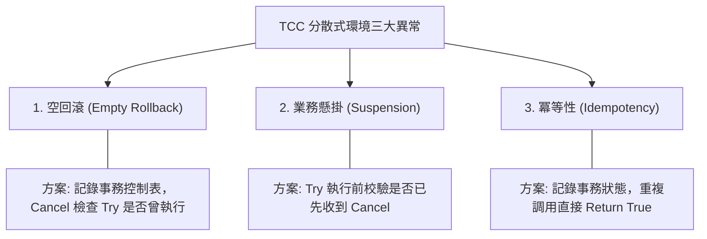

# 04. TCC 模式架構與三大異常設計

在追求極致高併發或涉及非關係型數據庫（如 Redis、MongoDB）與第三方外部系統調用時，**TCC (Try-Confirm-Cancel)** 模式是業界最佳實踐。

---

## 1. TCC 三階段語義

```java
@LocalTCC
public interface PaymentTccService {

    /**
     * 一階段：業務檢查與資源預留（凍結）
     */
    @TwoPhaseBusinessAction(name = "paymentTccAction", commitMethod = "confirm", rollbackMethod = "cancel")
    boolean prepare(@BusinessActionContextParameter(paramName = "orderId") String orderId,
                    @BusinessActionContextParameter(paramName = "amount") BigDecimal amount);

    /**
     * 二階段：確認執行（使用 Try 預留的資源，真正扣款）
     */
    boolean confirm(BusinessActionContext context);

    /**
     * 二階段：取消執行（釋放 Try 預留的資源，解凍）
     */
    boolean cancel(BusinessActionContext context);
}
```

---

## 2. TCC 面臨的三大核心異常與解決方案

在分散式網絡環境中，RPC 可能遭遇丟包、延遲與重試，TCC 必須妥善處理解決以下三大問題：



### 2.1 空回滾 (Empty Rollback)
* **現象**：一階段 Try 請求因為網路抖動壓根沒有到達服務端（或超時），TM 判定事務失敗發起全局回滾。此時 TC 調用 RM 的 Cancel 介面。Cancel 發現本地根本沒有 Try 相關數據。
* **危害**：如果 Cancel 盲目執行解凍邏輯，會造成數據超額返還（資金憑空增加）。
* **解決辦法**：Cancel 方法必須識別出「Try 從未執行過」，此時只記錄狀態，不做實質逆向資源釋放，直接返回成功。

### 2.2 業務懸掛 (Suspension)
* **現象**：RPC 網絡嚴重擁堵，Try 請求在傳輸中延遲。TC 超時觸發全局回滾，先調用了 Cancel 完成了空回滾。隨後，延遲已久的 Try 請求**終於到達**了 RM 服務端並執行了資源凍結。
* **危害**：該事務的 Cancel 已經執行完畢，TC 不會再次下發 Cancel，導致這筆預留的資源永遠被凍結無法釋放（即「懸掛」）。
* **解決辦法**：Try 執行前，先查詢事務控制表。若發現當前全局事務的 Cancel 已經執行過，則**拒絕執行 Try**。

### 2.3 冪等性問題 (Idempotency)
* **現象**：TC 下發 Confirm 或 Cancel 指令時，若發生網絡超時，TC 會進行定時重試，導致 Confirm 或 Cancel 被多次調用。
* **解決辦法**：Confirm / Cancel 方法必須保證冪等。若檢測到事務已經處於 `CONFIRMED` 或 `CANCELED` 狀態，直接返回成功，不可重複扣減或重複解凍。

---

## 3. TCC 事務控制表記錄設計

為解決上述問題，推薦在 RM 本地資料庫建立 TCC 狀態表：

```sql
CREATE TABLE `tcc_transaction_record` (
  `xid` VARCHAR(128) NOT NULL COMMENT '全局事務ID',
  `branch_id` BIGINT NOT NULL COMMENT '分支事務ID',
  `status` TINYINT NOT NULL COMMENT '狀態 (1: TRIED, 2: CONFIRMED, 3: CANCELED)',
  `gmt_create` DATETIME NOT NULL,
  PRIMARY KEY (`xid`, `branch_id`)
) ENGINE = InnoDB DEFAULT CHARSET = utf8mb4 COMMENT = 'TCC 控制狀態表';
```

### 標準處理流程模板：
1. **Try 方法**：
   - 檢查 `tcc_transaction_record` 是否存在且狀態為 `CANCELED`：如果是，直接拋出異常拒絕執行（**防懸掛**）。
   - 執行業務資源凍結。
   - 插入記錄，狀態為 `TRIED`。
2. **Confirm 方法**：
   - 檢查記錄狀態：若已為 `CONFIRMED`，直接返回 true（**冪等**）。
   - 執行正式扣減邏輯。
   - 更新狀態為 `CONFIRMED`。
3. **Cancel 方法**：
   - 檢查記錄：
     - 若無任何記錄：說明 Try 未執行，直接插入狀態為 `CANCELED` 的記錄（**防空回滾 & 防後續懸掛**），返回 true。
     - 若狀態已為 `CANCELED`：直接返回 true（**冪等**）。
   - 執行解凍邏輯。
   - 更新狀態為 `CANCELED`。
