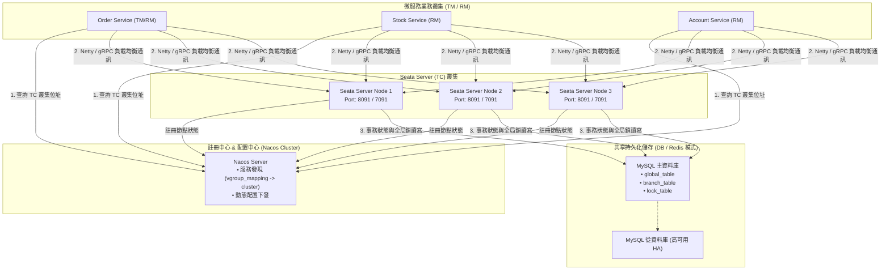

# 05. 生產環境部署與高可用架構 (HA)

Seata Server (TC) 是整個分散式事務的核心中樞。在生產環境中，必須保證 TC 具備高可用（HA）、故障自動轉移與水平擴展能力。

---

## 1. 生產部署架構圖



---

## 2. TC 儲存模式對比與選型

| 儲存模式 | 原理與特點 | 推薦環境 | 優缺點 |
| :--- | :--- | :--- | :--- |
| **file** | 本地單機檔案存儲，無法做叢集 | 本地開發、單元測試 | 簡單無外部依賴；無 HA，重啟資料易遺失 |
| **db (推薦)** | 事務狀態與全局鎖寫入共用關聯資料庫 (MySQL/PostgreSQL) | **中小規模生產環境** | 架構清晰、資料可靠性高；資料庫有一定連線與寫入負載 |
| **redis** | 事務狀態與全局鎖寫入 Redis 叢集 | **高併發大型生產環境** | 效能極高；依賴 Redis 哨兵/叢集的高可用配置 |
| **raft** | 基於 Raft 演算法由 TC 節點自身組建 Paxos/Raft 叢集 (Seata 1.5+) | 無需外部 DB 的雲原生容器化部署 | 自帶選主與強一致；對節點網路穩定性要求高 |

---

## 3. 事務分組 (Transaction Service Group) 機制

Seata 引入了「事務分組」來實現服務與 TC 叢集之間的邏輯解耦與平滑切換：

```text
業務微服務配置:
service.vgroupMapping.my_tx_group = default

Nacos 註冊中心:
查詢名為 "default" 的 Seata Server 叢集位址清單 (如: 10.0.0.1:8091, 10.0.0.2:8091)
```

### 事務分組優勢：
1. **多機房容災切換**：若機房 A 的 TC 叢集發生故障，只需在 Nacos 配置中心動態修改 `vgroupMapping` 指向機房 B 的 TC 叢集，微服務即可秒級切換，無需重啟。
2. **多租戶隔離**：不同業務線（如支付、物流行程）可映射到不同 TC 叢集，避免資源競爭。

---

## 4. TC 生產配置參考 (`application.yml`)

```yaml
server:
  port: 7091

seata:
  registry:
    type: nacos
    nacos:
      application: seata-server
      server-addr: 127.0.0.1:8848
      group: SEATA_GROUP
      namespace: prod-namespace
      cluster: default
  config:
    type: nacos
    nacos:
      server-addr: 127.0.0.1:8848
      group: SEATA_GROUP
      namespace: prod-namespace
  store:
    mode: db
    db:
      datasource: druid
      db-type: mysql
      driver-class-name: com.mysql.cj.jdbc.Driver
      url: jdbc:mysql://10.0.0.50:3306/seata_server?useUnicode=true&characterEncoding=utf8&useSSL=false
      user: seata_user
      password: seata_password
      min-conn: 10
      max-conn: 100
      max-wait: 5000
```
