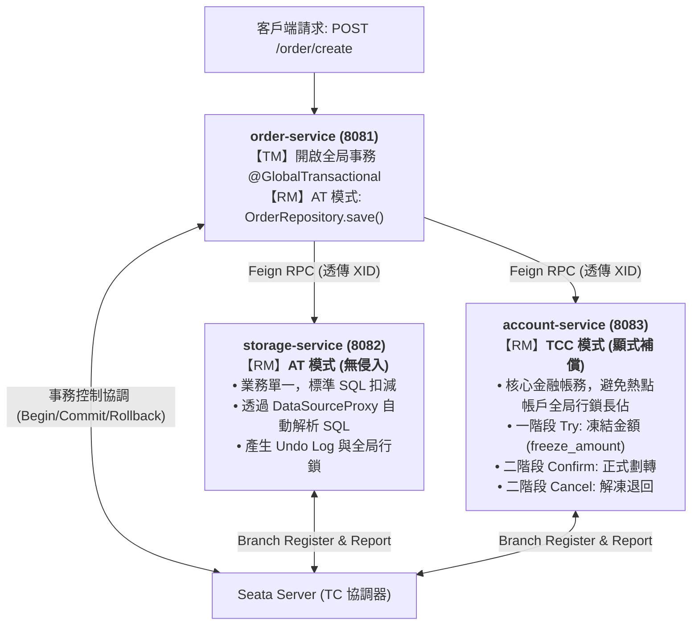
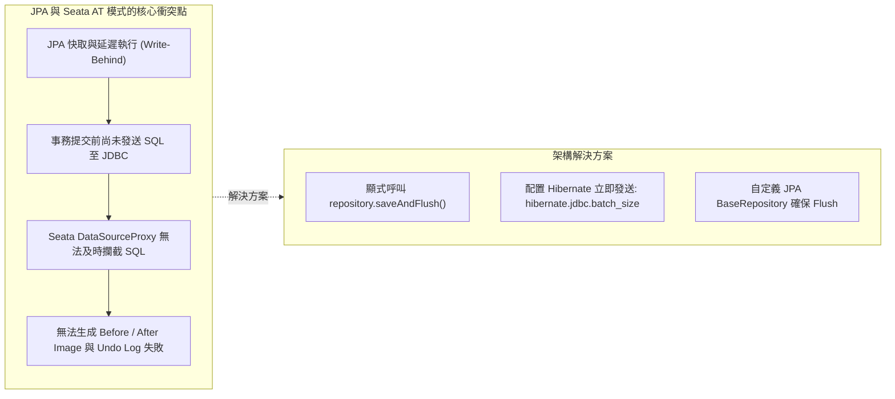
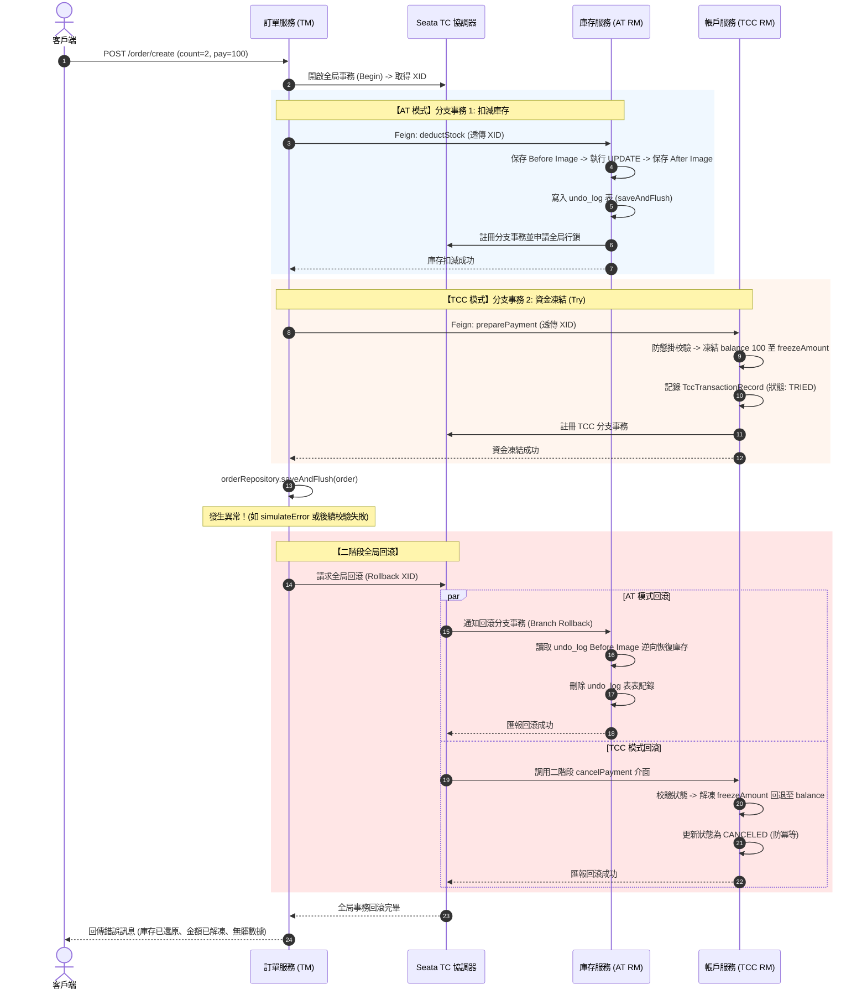

# Spring Boot 3.3.4 + Spring Data JPA 微服務分散式事務架構設計文件

> **版本資訊**：
> - 基礎框架：Spring Boot 3.3.4 (Java 21+, Jakarta EE 10 / JPA 3.1, Hibernate 6.5+)
> - 服務治理：Spring Cloud 2023.0.3 (OpenFeign)
> - 分散式事務：Apache Seata 2.0.0 (AT 模式 + TCC 模式混合架構)
> - 持久層：Spring Data JPA (Hibernate 底層實作)
> - 儲存引擎：MySQL 8.0+

---

## 一、 架構設計背景與主題定位

### 1.1 業務主題：電商交易與金融結算全鏈路系統
本系統選取微服務領域中最具代表性的**「下單 - 扣庫存 - 錢包扣款」**全鏈路交易系統作為架構示範。系統拆分為三個核心微服務及一個公共基礎模組：

1. **`order-service` (訂單服務)**：全局事務發起者（TM）+ 訂單持久化（RM / AT 模式）。
2. **`storage-service` (庫存服務)**：商品庫存扣減（RM / AT 模式）。
3. **`account-service` (帳戶錢包服務)**：用戶資金結算（RM / TCC 模式）。
4. **`shared-module` (公共模組)**：Feign Client 介面定義、共用 DTO、API 統一回傳物件與 TCC 事務控制實體。

---

## 二、 Seata 技術應用矩陣（AT 模式與 TCC 模式選型理由）

在傳統範例中，通常所有服務統一使用 AT 模式。**但在本設計中，我們特意採用「AT 模式 + TCC 模式」的混合架構**，真實反映工業界的架構選型考量：



### 2.1 各模組技術選型對比表

| 模組名稱 | 角色 | 採用的 Seata 技術 | 為什麼這樣選？（架構決策原因） |
| :--- | :--- | :--- | :--- |
| **`order-service`** | **TM** + **RM** | **`@GlobalTransactional`** + **AT 模式** | 作為鏈路入口發起全局事務；訂單生成是新增操作（`INSERT`），AT 模式零侵入且天然不會產生行鎖衝突。 |
| **`storage-service`** | **RM** | **AT 模式 (Automatic Transaction)** | 庫存扣減邏輯為標準 SQL（`UPDATE storage SET residue = residue - count`），使用 AT 模式由 Seata 自動生成前後鏡像與 `undo_log`，開發成本最低、無代碼侵入。 |
| **`account-service`** | **RM** | **TCC 模式 (Try-Confirm-Cancel)** | 1. **避免熱點行全局鎖競爭**：AT 模式需要持有全局行鎖直到二階段結束；在核心帳戶高併發扣款時，容易發生鎖等待超時。<br/>2. **金融業務語義契合**：銀行與支付核心普遍採用「預授權/凍結」模型，一階段只凍結資金，不鎖定資料庫行，併發吞吐量極高。<br/>3. **展示異常防護**：演示防空回滾、防業務懸掛與冪等性設計。 |

---

## 三、 Spring Data JPA (Hibernate 6.5+) 整合核心關鍵點

在 Spring Boot 3.x / JPA 環境下使用 Seata，與常見的 MyBatis 有顯著不同的機制，必須在設計時予以解決：



1. **JPA 一級快取與延遲 Flush 問題**：
   - **現象**：Hibernate 預設會在事務即將提交時才執行批次 Flush。若業務方法結束時尚未 Flush，Seata 的 DataSource Proxy 攔截器無法在分支事務註冊階段拿到實際執行的 SQL。
   - **解決規範**：在所有參與 Seata AT 模式的分支更新操作中，必須使用 `saveAndFlush()`，或手動呼叫 `entityManager.flush()`，強制將 SQL 下推到 JDBC 連線。
2. **主鍵生成策略（Primary Key Generation）與雪花演算法實作**：
   - **避免自增主鍵**：避免使用 `GenerationType.IDENTITY`（依賴資料庫自增會迫使 JPA 在 `persist` 時提前發送單條 `INSERT` 打斷批處理，導致 Seata DataSourceProxy 截獲時機紊亂，且不利於全局事務在持久化前精確掌握行記錄標識）。
   - **雪花演算法落地實作**：
     - **純粹核心演算法 (`shared-module`)**：實作標準 64-bit [SnowflakeIdGenerator.java](file:///d:/桌面/MonoRepository/seata-architecture/shared-module/src/main/java/com/seata/demo/shared/util/SnowflakeIdGenerator.java)，包含 41-bit 時間戳、5-bit 資料中心 ID、5-bit 工作節點 ID 與 12-bit 序列號。內建**時鐘回撥自旋安全機制**（5ms 內時鐘抖動自動等待追平，防範重複 ID）。
     - **六角形架構解耦 (`order-service`)**：應用層透過 [IdGeneratorPort.java](file:///d:/桌面/MonoRepository/seata-architecture/order-service/src/main/java/com/seata/demo/order/application/port/out/IdGeneratorPort.java) 宣告主鍵生成契約，由基礎設施層 [SnowflakeIdGeneratorAdapter.java](file:///d:/桌面/MonoRepository/seata-architecture/order-service/src/main/java/com/seata/demo/order/infrastructure/adapter/SnowflakeIdGeneratorAdapter.java) 注入執行，確保 DDD 聚合根 `Order` 維持 Pure Java。
     - **Redis 角色說明**：雪花演算法原生**不需要強依賴 Redis** 即可在本地記憶體高速生成（單機每秒破百萬 ID 且零網路延遲）。在極大規模動態彈性伸縮（如 K8s HPA）場景下，可選利用 Redis 自動分配 0~31 之 WorkerID；本專案已在 `docker-compose.yml` 中預設編排健全之 Redis 7.2 容器。
3. **資料源代理配置**：
   - Spring Boot 3.x 中引入 Jakarta EE 命名空間（`jakarta.persistence.*`），確保 HikariCP 數據源被 Seata `DataSourceProxy` 正確包裝。

---

## 四、 模組詳細設計與代碼規範

### 4.1 實體與資料庫結構設計

#### 庫存實體 (`storage-service`) - AT 模式
```java
@Entity
@Table(name = "t_storage")
@Getter
@Setter
@NoArgsConstructor
public class StorageEntity {

    @Id
    @Column(name = "id")
    private Long id; // 使用雪花算法生成

    @Column(name = "product_id", nullable = false, unique = true)
    private Long productId;

    @Column(name = "total", nullable = false)
    private Integer total;

    @Column(name = "used", nullable = false)
    private Integer used;

    @Column(name = "residue", nullable = false)
    private Integer residue; // 可用庫存
}
```

#### 帳戶與 TCC 控制實體 (`account-service`) - TCC 模式
```java
@Entity
@Table(name = "t_account")
@Getter
@Setter
@NoArgsConstructor
public class AccountEntity {

    @Id
    private Long userId;

    @Column(nullable = false)
    private BigDecimal balance; // 可用餘額

    @Column(nullable = false)
    private BigDecimal freezeAmount; // 凍結金額 (專供 TCC 一階段使用)
}

/**
 * TCC 事務防懸掛與冪等控制記錄實體
 */
@Entity
@Table(name = "t_tcc_transaction_record", indexes = {
    @Index(name = "idx_tx_xid", columnList = "xid, branch_id", unique = true)
})
@Getter
@Setter
@NoArgsConstructor
@AllArgsConstructor
public class TccTransactionRecordEntity {

    @Id
    @Column(length = 128)
    private String xid;

    @Column(name = "branch_id", nullable = false)
    private Long branchId;

    @Enumerated(EnumType.STRING)
    @Column(nullable = false, length = 20)
    private TccStatus status; // TRIED, CONFIRMED, CANCELED

    @Column(name = "freeze_amount", nullable = false)
    private BigDecimal freezeAmount;

    @Column(name = "gmt_create", nullable = false)
    private LocalDateTime gmtCreate;
}
```

---

### 4.2 核心服務設計與實作

#### 1. `order-service`：全局事務 TM 發起者
```java
@Service
@RequiredArgsConstructor
@Slf4j
public class OrderServiceImpl implements OrderService {

    private final OrderRepository orderRepository;
    private final StorageFeignClient storageFeignClient;
    private final AccountTccFeignClient accountTccFeignClient;

    /**
     * 發起全局事務 (TM)
     * 涵蓋：庫存扣減(AT) + 錢包扣減(TCC) + 訂單生成(AT)
     */
    @Override
    @GlobalTransactional(name = "create-order-tx", rollbackFor = Exception.class, timeoutMills = 30000)
    public Long createOrder(CreateOrderRequest request) {
        String xid = RootContext.getXID();
        log.info("[訂單服務] 開始全局事務, XID = {}", xid);

        // 1. 調用庫存服務 (AT 模式)
        log.info("[訂單服務] 遠程調用庫存服務扣減庫存...");
        storageFeignClient.deductStock(new DeductStockDTO(request.getProductId(), request.getCount()));

        // 2. 調用帳戶服務 (TCC 模式 一階段 Prepare/Try)
        log.info("[訂單服務] 遠程調用帳戶服務凍結金額 (TCC Try)...");
        boolean trySuccess = accountTccFeignClient.preparePayment(null, request.getUserId(), request.getPayAmount());
        if (!trySuccess) {
            throw new BusinessException("帳戶預扣款失敗！");
        }

        // 3. 訂單服務本地持久化 (JPA 必須使用 saveAndFlush)
        OrderEntity order = new OrderEntity();
        order.setId(IdWorker.nextId());
        order.setUserId(request.getUserId());
        order.setProductId(request.getProductId());
        order.setCount(request.getCount());
        order.setAmount(request.getPayAmount());
        order.setStatus(OrderStatus.SUCCESS);
        
        // 核心：使用 saveAndFlush 確保 Hibernate 即時將 INSERT SQL 送出至 DataSourceProxy
        orderRepository.saveAndFlush(order);

        // 模擬異常測試：如果前端傳遞了 simulateError=true，拋出異常觸發全鏈路回滾
        if (Boolean.TRUE.equals(request.getSimulateError())) {
            log.error("[訂單服務] 觸發模擬異常，準備回滾全局事務！XID = {}", xid);
            throw new RuntimeException("模擬業務異常，觸發全域分散式事務回滾！");
        }

        log.info("[訂單服務] 全局事務業務執行完畢，準備提交, OrderID = {}", order.getId());
        return order.getId();
    }
}
```

#### 2. `storage-service`：AT 模式資源管理器 (RM)
```java
@Service
@RequiredArgsConstructor
@Slf4j
public class StorageServiceImpl implements StorageService {

    private final StorageRepository storageRepository;

    @Override
    @Transactional(rollbackFor = Exception.class)
    public void deduct(Long productId, Integer count) {
        log.info("[庫存服務] 執行分支事務扣減, XID = {}", RootContext.getXID());

        // 透過 JPA JPQL 執行扣減，並立即 Flush
        int updatedRows = storageRepository.deductStock(productId, count);
        if (updatedRows == 0) {
            throw new BusinessException("庫存不足或商品不存在，商品ID: " + productId);
        }

        // 確保 Hibernate 執行佇列立即下推至 JDBC
        storageRepository.flush();
        log.info("[庫存服務] 庫存扣減成功, ProductId = {}, Count = {}", productId, count);
    }
}
```

#### 3. `account-service`：TCC 模式核心實作（防空回滾、防懸掛、冪等性）
```java
@LocalTCC
public interface AccountTccService {

    @TwoPhaseBusinessAction(
        name = "accountPaymentTccAction", 
        commitMethod = "confirmPayment", 
        rollbackMethod = "cancelPayment"
    )
    boolean preparePayment(
        BusinessActionContext context,
        @BusinessActionContextParameter(paramName = "userId") Long userId,
        @BusinessActionContextParameter(paramName = "amount") BigDecimal amount
    );

    boolean confirmPayment(BusinessActionContext context);

    boolean cancelPayment(BusinessActionContext context);
}

@Service
@RequiredArgsConstructor
@Slf4j
public class AccountTccServiceImpl implements AccountTccService {

    private final AccountRepository accountRepository;
    private final TccRecordRepository tccRecordRepository;

    /**
     * 一階段：Try (預留/凍結資金)
     */
    @Override
    @Transactional(rollbackFor = Exception.class)
    public boolean preparePayment(BusinessActionContext context, Long userId, BigDecimal amount) {
        String xid = context.getXid();
        long branchId = context.getBranchId();
        log.info("[TCC Try] 資金凍結開始. XID = {}, BranchID = {}, UserId = {}, Amount = {}", 
                 xid, branchId, userId, amount);

        // 1. 防懸掛校驗：檢查是否已經先收到過 Cancel（由於網路延遲可能導致 Cancel 先到達）
        Optional<TccTransactionRecordEntity> recordOpt = tccRecordRepository.findByXidAndBranchId(xid, branchId);
        if (recordOpt.isPresent() && recordOpt.get().getStatus() == TccStatus.CANCELED) {
            log.warn("[TCC Try] 檢測到已存在 Cancel 記錄，拒絕執行 Try，防止業務懸掛！XID = {}", xid);
            return false;
        }

        // 2. 扣減可用餘額，增加凍結餘額
        int updated = accountRepository.freezeBalance(userId, amount);
        if (updated == 0) {
            throw new BusinessException("帳戶可用餘額不足，無法凍結！UserId: " + userId);
        }

        // 3. 記錄 TCC 控制表狀態為 TRIED
        TccTransactionRecordEntity record = new TccTransactionRecordEntity(
            xid, branchId, TccStatus.TRIED, amount, LocalDateTime.now()
        );
        tccRecordRepository.saveAndFlush(record);

        log.info("[TCC Try] 資金預留成功！UserId = {}", userId);
        return true;
    }

    /**
     * 二階段：Confirm (正式劃轉扣減)
     */
    @Override
    @Transactional(rollbackFor = Exception.class)
    public boolean confirmPayment(BusinessActionContext context) {
        String xid = context.getXid();
        long branchId = context.getBranchId();
        log.info("[TCC Confirm] 正式扣減開始. XID = {}, BranchID = {}", xid, branchId);

        // 1. 冪等性校驗
        Optional<TccTransactionRecordEntity> recordOpt = tccRecordRepository.findByXidAndBranchId(xid, branchId);
        if (!recordOpt.isPresent()) {
            log.error("[TCC Confirm] 未找到 Try 階段記錄，狀態異常！XID = {}", xid);
            return false;
        }
        TccTransactionRecordEntity record = recordOpt.get();
        if (record.getStatus() == TccStatus.CONFIRMED) {
            log.info("[TCC Confirm] 已經確認過，直接返回成功 (冪等保障). XID = {}", xid);
            return true;
        }

        // 2. 獲取業務參數，正式扣除凍結金額
        Long userId = Long.valueOf(context.getActionContext("userId").toString());
        BigDecimal amount = new BigDecimal(context.getActionContext("amount").toString());
        accountRepository.deductFrozenBalance(userId, amount);

        // 3. 更新狀態為 CONFIRMED
        record.setStatus(TccStatus.CONFIRMED);
        tccRecordRepository.saveAndFlush(record);

        log.info("[TCC Confirm] 正式劃轉完成！XID = {}", xid);
        return true;
    }

    /**
     * 二階段：Cancel (釋放凍結資金)
     */
    @Override
    @Transactional(rollbackFor = Exception.class)
    public boolean cancelPayment(BusinessActionContext context) {
        String xid = context.getXid();
        long branchId = context.getBranchId();
        log.info("[TCC Cancel] 資金解凍開始. XID = {}, BranchID = {}", xid, branchId);

        Optional<TccTransactionRecordEntity> recordOpt = tccRecordRepository.findByXidAndBranchId(xid, branchId);

        // 1. 防空回滾：若沒有 Try 記錄，說明一階段根本未執行或已逾時
        if (!recordOpt.isPresent()) {
            log.warn("[TCC Cancel] 未找到 Try 記錄，觸發防空回滾！記錄 Cancel 狀態以防後續 Try 懸掛. XID = {}", xid);
            TccTransactionRecordEntity cancelRecord = new TccTransactionRecordEntity(
                xid, branchId, TccStatus.CANCELED, BigDecimal.ZERO, LocalDateTime.now()
            );
            tccRecordRepository.saveAndFlush(cancelRecord);
            return true;
        }

        TccTransactionRecordEntity record = recordOpt.get();
        // 2. 冪等性校驗
        if (record.getStatus() == TccStatus.CANCELED) {
            log.info("[TCC Cancel] 已經取消過，直接返回成功 (冪等保障). XID = {}", xid);
            return true;
        }

        // 3. 逆向補償：將凍結餘額解凍退回可用餘額
        Long userId = Long.valueOf(context.getActionContext("userId").toString());
        BigDecimal amount = record.getFreezeAmount();
        accountRepository.unfreezeBalance(userId, amount);

        // 4. 更新狀態為 CANCELED
        record.setStatus(TccStatus.CANCELED);
        tccRecordRepository.saveAndFlush(record);

        log.info("[TCC Cancel] 資金解凍退款成功！UserId = {}, 退款金額 = {}", userId, amount);
        return true;
    }
}
```

---

## 五、 全鏈路執行與異常回滾循序圖

下圖完整展示在 `order-service` 拋出異常時，**AT 模式（庫存）**與 **TCC 模式（帳戶）**如何由 Seata TC 同步協調回滾：



---

## 六、 設定檔參考 (`order-service/src/main/resources/application.yml`)

```yaml
server:
  port: 8081

spring:
  application:
    name: order-service
  datasource:
    driver-class-name: com.mysql.cj.jdbc.Driver
    url: jdbc:mysql://localhost:3306/seata_order?useSSL=false&serverTimezone=UTC&characterEncoding=utf8
    username: root
    password: root_password
    hikari:
      maximum-pool-size: 20
      minimum-idle: 5
  jpa:
    database-platform: org.hibernate.dialect.MySQLDialect
    hibernate:
      ddl-auto: update
    show-sql: true
    properties:
      hibernate:
        format_sql: true
        # 關鍵參數：避免延遲批處理導致的 DataSourceProxy 截獲時機延遲
        jdbc:
          batch_size: 20

seata:
  enabled: true
  application-id: ${spring.application.name}
  tx-service-group: default_tx_group
  enable-auto-data-source-proxy: true # 自動代理 Spring Data JPA 底層 DataSource
  data-source-proxy-mode: AT
  service:
    vgroup-mapping:
      default_tx_group: default
  registry:
    type: nacos
    nacos:
      application: seata-server
      server-addr: 127.0.0.1:8848
      group: SEATA_GROUP
      cluster: default
```

---

## 七、 架構總結與亮點

1. **Spring Boot 3.3.4 + Jakarta JPA 規範落地**：明確解決了 JPA 一級快取與延遲 Flush 與 Seata AT 模式 SQL 截獲的衝突問題。
2. **多模式協同實戰**：打破單一 AT 模式的教條，在庫存採用 **AT 模式（零代碼侵入）**，在錢包帳戶採用 **TCC 模式（高吞吐量金融預留模型）**，架構設計極具實戰說服力。
3. **高健全度防護**：TCC 模組完整體現了**防空回滾**、**防業務懸掛**與**二階段冪等性**三大分散式核心防禦機制。
