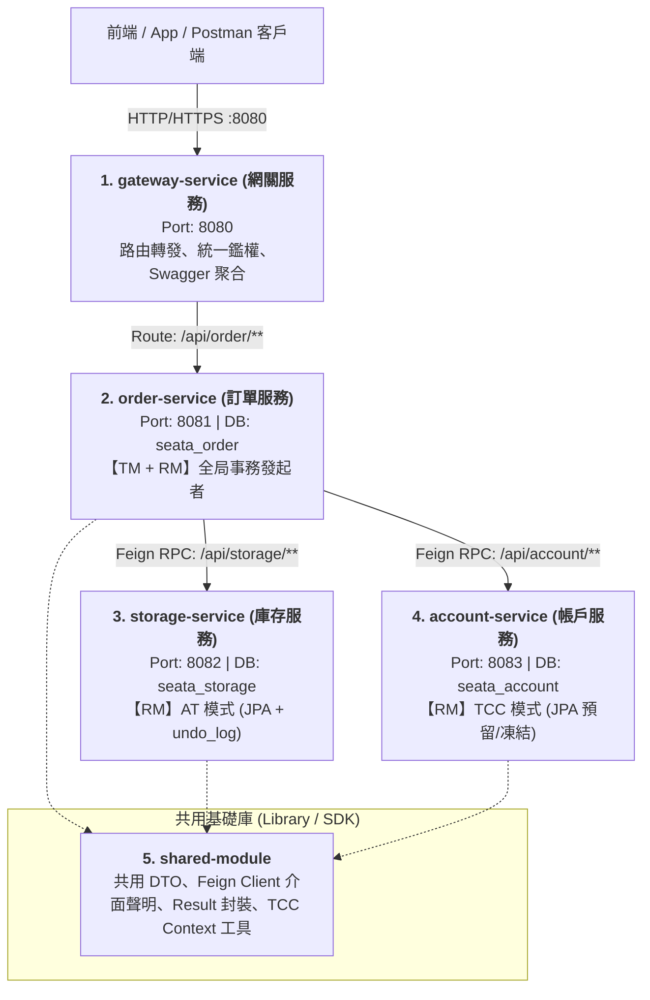
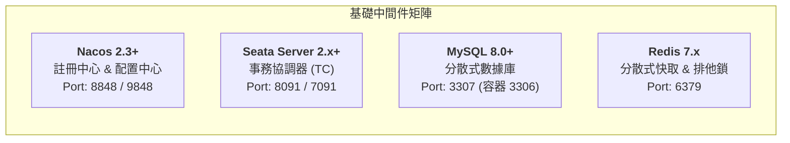
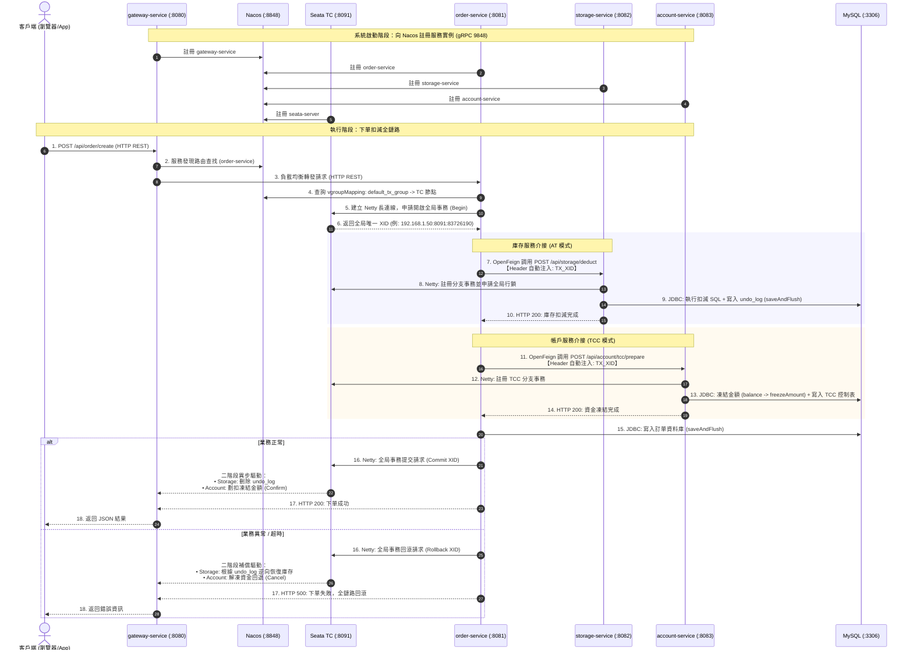

# 08. 微服務數量規格、中間件選型與全鏈路介接架構文件

> 本文件詳細定義系統中的**微服務清單與職責**、**所需中間件矩陣與規格**、**各服務與中間件之間的通訊協議與介接拓撲**，並提供標準的介接介面合約與 Docker Compose 部署配置。

---

## 一、 微服務數量與職責規格

本系統共由 **4 個獨立運行的微服務進程** 與 **1 個共用基礎模組** 組成：



### 1.1 服務清單詳細定義

| 序號 | 服務/模組名稱 | 服務類型 | 連接埠 (Port) | 數據庫實例 | Seata 角色與模式 | 核心職責 |
| :--- | :--- | :--- | :--- | :--- | :--- | :--- |
| 1 | **`gateway-service`** | 邊界網關 | `8080` | 無 | 不參與事務 | 外部流量統一入口、動態路由轉發、跨域 (CORS) 處理、API 鑑權。 |
| 2 | **`order-service`** | 業務核心 | `8081` | `seata_order` | **TM** + **RM (AT)** | 全局事務入口（標記 `@GlobalTransactional`），向 TC 申請 XID，協調庫存與帳戶扣減，持久化訂單。 |
| 3 | **`storage-service`** | 領域服務 | `8082` | `seata_storage` | **RM (AT 模式)** | 商品庫存維護，執行扣庫存 SQL，自動捕獲前後鏡像並寫入 `undo_log`，由 TC 驅動二階段提交或回滾。 |
| 4 | **`account-service`** | 領域服務 | `8083` | `seata_account` | **RM (TCC 模式)** | 用戶資金結算，提供 Try(凍結)、Confirm(正式劃扣)、Cancel(解凍退款) 三階段介面，具備防空回滾與防懸掛。 |
| 5 | **`shared-module`** | 共用模組 | - | - | - | 提供跨服務調用的 Feign Client 介面、通用 Request/Response DTO、全局例外碼與常數定義。 |

---

## 二、 所需中間件矩陣與規格

系統穩定運行共需要 **4 大核心中間件**：



| 中間件名稱 | 建議版本 | 監聽 Port | 角色與作用 | 高可用 (HA) 方案 |
| :--- | :--- | :--- | :--- | :--- |
| **Nacos** | 2.3.2+ | `8848` (HTTP)<br/>`9848` (gRPC) | 1. **服務註冊與發現**：管理所有微服務實例。<br/>2. **動態配置中心**：下發業務參數與 Seata 事務分組配置。<br/>3. **事務分組映射**：將 `vgroup-mapping` 解析為 Seata 叢集。 | 3 節點 Nacos 集群 + 外置 MySQL |
| **Seata Server (TC)** | 2.1.0+ | `8091` (Netty)<br/>`7091` (HTTP API) | 1. **事務協調中樞**：維護全局事務與分支事務狀態機。<br/>2. **全局鎖管理**：管理 AT 模式全局行鎖（`lock_table`）。<br/>3. **驅動 2PC**：向各微服務 RM 發送 Commit/Rollback 指令。 | 多節點集群，狀態持久化至共用 MySQL（DB 模式）或 Raft 模式 |
| **MySQL** | 8.0.32+ | `3307` (映射自容器 3306) | 1. **業務數據儲存**：各自隔離的 `seata_order`, `seata_storage`, `seata_account` 數據庫。<br/>2. **Seata 狀態儲存**：`seata_server` 數據庫（儲存 `global_table`, `branch_table`, `lock_table`）。 | 主從複製 + MHA / Orchestrator 或雲端 RDS HA |
| **Redis** | 7.2+ | `6379` | 1. **冪等性防重複提交**：訂單下單防抖。<br/>2. **熱點商品快取**：讀寫分離緩存。<br/>3. **Seata 狀態高速儲存** (可選)：若 TC 採用 Redis 模式，提供微秒級事務鎖存取。 | Redis Sentinel (哨兵) 或 Redis Cluster |

---

## 三、 全鏈路介接通訊架構與通訊協定



### 3.1 各組件通訊協議詳解

1. **外部客戶端 $\to$ `gateway-service`**：
   - **通訊協議**：`HTTP/1.1` 或 `HTTP/2` (JSON Payload)。
   - **安全認證**：可在 Gateway 增加 JWT 攔截與 Rate Limiting 限流。
2. **`gateway-service` $\to$ 業務微服務**：
   - **通訊協議**：`Spring Cloud LoadBalancer` + `HTTP REST`。
   - **路由策略**：
     - `/api/order/**` $\to$ `lb://order-service`
     - `/api/storage/**` $\to$ `lb://storage-service`
     - `/api/account/**` $\to$ `lb://account-service`
3. **微服務 $\to$ 微服務 (跨服務 RPC)**：
   - **通訊協議**：`Spring Cloud OpenFeign`（底層基於 OkHttp 或 Apache HttpClient）。
   - **XID 傳播關鍵機制**：
     Seata 提供 Feign 請求攔截器 `SeataFeignClientInterceptor`，會在每一次 Feign 請求呼叫前執行：
     ```java
     String xid = RootContext.getXID();
     if (StringUtils.isNotBlank(xid)) {
         template.header(RootContext.KEY_XID, xid); // 即在 Header 放入 "TX_XID: <xid>"
     }
     ```
     下游服務的 `SeataHandlerInterceptor` 收到請求後，讀取 Header 中的 `TX_XID`，並呼叫 `RootContext.bind(xid)` 綁定到下游現程的 `ThreadLocal` 中，達成全鏈路事務追蹤。
4. **微服務 $\to$ Nacos**：
   - **通訊協議**：`gRPC`（長連線雙向串流，預設埠為 `8848 + 1000 = 9848`）。
   - **職責**：心跳保活、微服務上下線動態感知、事務分組動態尋址。
5. **微服務 (TM/RM) $\to$ Seata Server (TC)**：
   - **通訊協議**：高效能雙向長連線 **Netty RPC**（埠 `8091`）。
   - **傳輸內容**：二進位自定義協議封裝（事務 Begin、分支 Register、分支狀態 Report、二階段 Commit/Rollback 指令發送）。
6. **微服務 $\to$ MySQL**：
   - **通訊協議**：標準 `MySQL Protocol` (JDBC)。
   - **代理機制**：透過 `seata.enable-auto-data-source-proxy: true`，Seata 會用 `DataSourceProxy` 包裝 Spring Boot HikariCP 連線池，自動在 `Connection.commit()` 時執行 SQL 解析與鏡像產生。

---

## 四、 服務間介接 API 介面規格書 (API Contract)

### 4.1 訂單服務下單介面
* **調用方**：前端客戶端 / API 網關
* **提供方**：`order-service`
* **請求路徑**：`POST /api/order/create`
* **請求體 (Request Body)**：
  ```json
  {
    "userId": 10001,
    "productId": 20001,
    "count": 2,
    "payAmount": 500.00,
    "simulateError": false
  }
  ```
* **回應體 (Response Body)**：
  ```json
  {
    "code": 200,
    "message": "下單成功",
    "data": {
      "orderId": 7382910485729104,
      "status": "SUCCESS"
    }
  }
  ```

### 4.2 庫存服務扣減介面 (AT 模式)
* **調用方**：`order-service` (via OpenFeign)
* **提供方**：`storage-service`
* **請求路徑**：`POST /api/storage/deduct`
* **Header 要求**：`TX_XID: <xid>`（由 Seata Feign 攔截器自動攜帶）
* **請求體 (Request Body)**：
  ```json
  {
    "productId": 20001,
    "count": 2
  }
  ```
* **回應體 (Response Body)**：
  ```json
  {
    "code": 200,
    "message": "庫存扣減成功"
  }
  ```

### 4.3 帳戶服務 TCC 預留凍結介面 (TCC Try)
* **調用方**：`order-service` (via OpenFeign)
* **提供方**：`account-service`
* **請求路徑**：`POST /api/account/tcc/prepare`
* **Header 要求**：`TX_XID: <xid>`
* **請求體 (Request Body)**：
  ```json
  {
    "userId": 10001,
    "amount": 500.00
  }
  ```
* **二階段回調（由 Seata TC Server 透過 Netty RPC 直接下發指令）**：
  - **Confirm**：執行 `confirmPayment(BusinessActionContext context)`，扣除凍結金額。
  - **Cancel**：執行 `cancelPayment(BusinessActionContext context)`，解凍金額退回可用餘額。

---

## 五、 一鍵式中間件容器化編排 (`docker-compose.yml`)

為確保團隊開發與測試環境能快速重現完整的微服務基礎設施，工作區根目錄提供了完整的 Docker Compose 編排檔：

👉 [docker-compose.yml](file:///d:/桌面/MonoRepository/seata-architecture/docker-compose.yml)

### 啟動指令：
```bash
# 1. 啟動所有基礎中間件 (MySQL, Nacos, Seata Server, Redis)
docker-compose up -d

# 2. 檢查各容器健康狀態
docker-compose ps
```

### 存取控制台端點：
* **Nacos 控制台**：`http://localhost:8848/nacos`（帳號密碼：`nacos` / `nacos`）
* **Seata 控制台**：`http://localhost:7091`（帳號密碼：`seata` / `seata`）
* **MySQL 伺服器**：`localhost:3307`（root / root_password）
