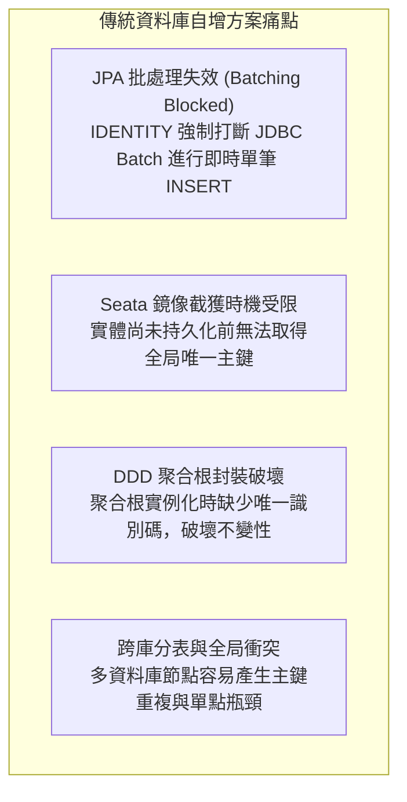
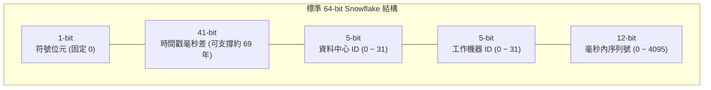
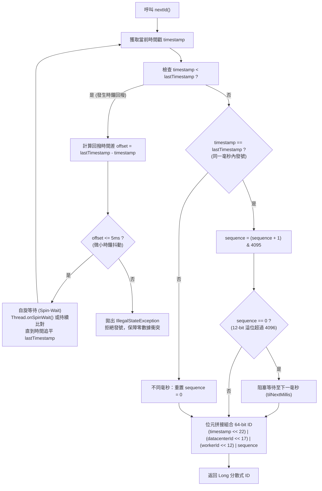
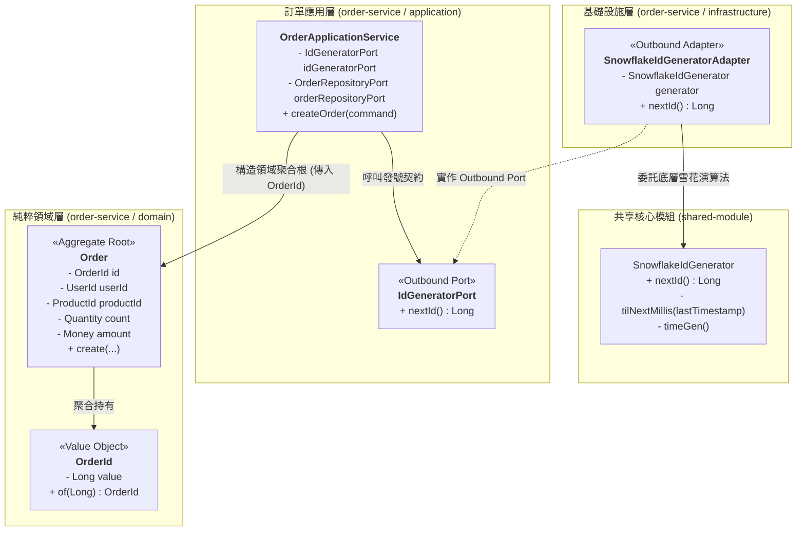

# 分散式雪花演算法 (Snowflake) 架構設計與企業級落地技術白皮書

本文件詳細闡述在大型分散式微服務架構與 Apache Seata 分散式事務體系中，全鏈路唯一識別碼（Distributed Unique ID）的設計考量、選型權衡、底層 64-bit 位元運算機制、時鐘回撥防禦策略，以及如何將其優雅融合進 **Domain-Driven Design (DDD)** 與 **六角形架構 (Hexagonal Architecture)**。

---

## 一、 分散式主鍵架構痛點與選型權衡 (Why Snowflake?)

在傳統單體架構中，資料庫的自增主鍵（`AUTO_INCREMENT`）或 JPA 的 `@GeneratedValue(strategy = GenerationType.IDENTITY)` 是最直接的方案。然而在分散式系統、微服務架構與分散式事務場景中，傳統方案會面臨嚴重的架構瓶頸：

### 1. 傳統方案四大痛點



1. **JPA 延遲 Flush 機制與 JDBC 批處理（Batch Insert）被打斷**：
   - Hibernate 對於 `GenerationType.IDENTITY` 的實體，無法使用延遲 Flush 機制。為了獲取資料庫生成的 ID，Hibernate 被迫對每一筆資料立即執行單獨的 `INSERT` 語句，徹底破壞了 `hibernate.jdbc.batch_size` 批處理效能。
2. **Seata AT 模式鏡像截獲與長鏈路傳播受限**：
   - 在分散式事務發起階段（TM），業務若需要先生成訂單聚合根、在領域事件中攜帶 `OrderId`，或將其跨 RPC 透傳給庫存與帳戶服務作為冪等業務憑據，自增 ID 無法在呼叫外部服務前預先獲取。
3. **DDD 領域驅動設計之聚合根純粹性原則衝突**：
   - 根據 DDD 規範，聚合根在記憶體中被實例化時，就必須具備全局唯一的業務標識符（`OrderId`）。如果主鍵必須依賴資料庫持久化才能取得，領域物件在落庫前便處於「無標識」的非法狀態，破壞了領域模型的不變性（Invariants）。
4. **跨分庫分表（Database Sharding）的全局唯一性**：
   - 當資料庫採用分庫分表或跨多微服務實體隔離時，單一資料庫實例的自增序列無法保障全域唯一性。

---

### 2. 分散式 ID 生成技術橫向評估矩陣

| 選型方案 | 生成原理 | 吞吐效能 (TPS) | 網路開銷 | 趨勢遞增性 | 外部相依性 | 適用場景與評估 |
| :--- | :--- | :--- | :--- | :--- | :--- | :--- |
| **UUID / GUID** | 本地隨機數 / MAC / 時間戳 | 極高 (千萬級) | **0 ms** (本地) | **完全無序** | 零依賴 | ❌ 產生 36 字元字串，佔用存儲大，且無序寫入會引發 MySQL InnoDB B+Tree 劇烈的**頁面分裂 (Page Split)**，導致索引效率低落。 |
| **資料庫號段模式** (如 Leaf-segment) | 批量從資料庫獲取號段，記憶體緩衝發號 | 較高 (10萬 ~ 50萬) | 低 (批量拉取) | 嚴格遞增 | 依賴資料庫 | ⚠️ 仍需依賴關聯式資料庫，架構較為厚重，跨地域或機房災備複雜度高。 |
| **Redis 自增** (`INCR` / `INCRBY`) | 依賴 Redis 單執行緒原子累加 | 中等 (5萬 ~ 10萬) | 較高 (網路 RTT) | 嚴格遞增 | 依賴 Redis 高可用叢集 | ⚠️ 每產生一筆 ID 均需一次網路 I/O，遇到網路抖動時會成為核心下單鏈路的效能瓶頸。 |
| **Twitter Snowflake** (本專案實作) | **純記憶體 64-bit 位元運算**<br/>(時間戳 + 機房ID + 機器ID + 序號) | **極高 (單機 400 萬/秒)** | **0 ms** (本地 CPU) | **趨勢遞增** | **零依賴** (純 Java) |  **最佳實踐**：64-bit Long 完全對齊 MySQL `BIGINT` (8 Bytes)，緊湊高儲存效率；天然時間有序保障 B+Tree 循序寫入；零外部依賴保障微服務最高可用性。 |

---

## 二、 Twitter Snowflake 演算法底層 64-bit 結構解析

本專案實作之 [SnowflakeIdGenerator](file:///d:/桌面/MonoRepository/seata-architecture/shared-module/src/main/java/com/seata/demo/shared/util/SnowflakeIdGenerator.java) 嚴格遵循標準 64-bit 二進位結構設計：



### 1. 各區段二進位位元分配詳解

| 欄位名稱 | 位元長度 (Bits) | 取值範圍 (Decimal) | 位移運算 (Shift) | 功能與設計用意 |
| :--- | :--- | :--- | :--- | :--- |
| **符號位元 (Sign Bit)** | 1 bit | 0 | `>> 63` | 固定為 `0`，確保產生的 64 位元整數在 Java `long` 型別中永遠為**正數**。 |
| **時間戳 (Timestamp)** | 41 bits | 0 ~ 2,199,023,255,551 | `<< 22` | 儲存自定義 Epoch（基準時間，本專案設定為 `1704067200000L`，即 2024-01-01 00:00:00 UTC）以來的毫秒差。$2^{41} \div (1000 \times 60 \times 60 \times 24 \times 365) \approx 69.7$ 年。 |
| **資料中心 ID (Datacenter ID)** | 5 bits | 0 ~ 31 | `<< 17` | 用於標識實體機房或可用區（Availability Zone, AZ），最多支援 32 個獨立資料中心。 |
| **工作機器 ID (Worker ID)** | 5 bits | 0 ~ 31 | `<< 12` | 用於標識同一資料中心內的微服務節點或容器實例，單一機房最多支援 32 台節點。 |
| **序列號 (Sequence Number)** | 12 bits | 0 ~ 4095 | `<< 0` | 單一節點在同一毫秒內產生的序列計數器。單節點每毫秒可產生 4096 個獨立 ID，單機理論峰值吞吐達 **4,096,000 ID/sec**。 |

---

## 三、 時鐘回撥（Clock Drift）核心防禦機制

### 1. 什麼是時鐘回撥？
在現代雲原生環境中，作業系統的時間通常透過 NTP（Network Time Protocol）與時間伺服器進行時間同步校正。當機器時間出現快慢漂移，NTP 進行向後校正時，會發生「當前系統時間小於上次發號時間」的現象，這就是**時鐘回撥**。如果演算法未做防護，就會在回撥的時間區間內產生出**完全重複的 ID**，造成分散式系統嚴重的數據污染。

### 2. 本專案之雙層防禦實作策略

在 [SnowflakeIdGenerator.java](file:///d:/桌面/MonoRepository/seata-architecture/shared-module/src/main/java/com/seata/demo/shared/util/SnowflakeIdGenerator.java) 中，我們設計了自旋等待與硬中斷的雙層防護機制：



```java
// 核心時鐘回撥防禦程式碼
if (timestamp < lastTimestamp) {
    long offset = lastTimestamp - timestamp;
    if (offset <= MAX_BACKWARD_MS) { // 預設容忍 5ms
        try {
            // 微小時鐘回撥：透過短暫 sleep / 自旋追平時間
            Thread.sleep(offset);
            timestamp = timeGen();
            if (timestamp < lastTimestamp) {
                throw new IllegalStateException("時鐘回撥自旋等待後仍未追平時間");
            }
        } catch (InterruptedException e) {
            Thread.currentThread().interrupt();
            throw new IllegalStateException("時鐘回撥等待被中斷", e);
        }
    } else {
        // 嚴重時鐘回撥：硬性阻斷，拒絕產生重複 ID
        throw new IllegalStateException(String.format(
            "系統時鐘發生重大回撥！拒絕產生 ID。回撥時長: %d 毫秒 (上次: %d, 當前: %d)",
            offset, lastTimestamp, timestamp));
    }
}
```

---

## 四、 節點 Worker ID 分配策略與 Redis 的角色定位

在分散式叢集中，確保所有節點的 `(datacenterId, workerId)` 二元組不重複是雪花演算法不發生碰撞的先決條件。

### 1. Redis 在雪花演算法中的定位：可選的輔助協調者
- **本專案的核心發號邏輯完全不依賴 Redis**：ID 是在本地記憶體中透過位元運算瞬間完成，零網路 I/O，保證百萬級高吞吐與零外部依賴。
- **Redis 的可選角色：動態 Worker ID 租約註冊中心**：
  - 在大型動態容器化環境（例如 Kubernetes Pod 自動水平擴縮容 HPA）中，Pod 頻繁銷毀與重啟，靜態指定 Worker ID 容易產生衝突。
  - 此時可引入 Redis 作為協調者：微服務啟動時向 Redis 執行 `INCR seata:snowflake:worker_id` 取模 32 作為自身的 `workerId`，並透過 Redis Key 的 TTL 租約機制進行心跳續約，下線自動釋放，避免手動配置維護。

### 2. 本專案支援的三種節點配置模式

1. **靜態宣告模式 (Static Config)**：
   - 透過 Spring Boot 配置檔或環境變數注入：
     ```yaml
     snowflake:
       datacenter-id: 1
       worker-id: 1
     ```
2. **網卡 MAC + 進程 PID 自適應運算模式 (Adaptive Fallback)**：
   - [SnowflakeIdGenerator.java](file:///d:/桌面/MonoRepository/seata-architecture/shared-module/src/main/java/com/seata/demo/shared/util/SnowflakeIdGenerator.java) 內建無參建構子：
     - `datacenterId`：自適應讀取本機第一個有效網路卡之 MAC 位址最後 2 個 Bytes 計算 Hash 取模 32。
     - `workerId`：自適應讀取當前 JVM 進程 PID（Process ID）取模 32。
     - 在無任何配置或本機開發時，即可開箱即用且保證不同進程/機器間不衝突。
3. **動態租約模式 (Redis Lease Coordination)**：
   - 配合 [docker-compose.yml](file:///d:/桌面/MonoRepository/seata-architecture/docker-compose.yml) 中的 Redis 容器，於擴展大規模生產叢集時透過 Redis 分配動態 Worker ID。

---

## 五、 六角形架構與純粹 DDD 實踐

本專案嚴格遵循 [.agents/AGENTS.md](file:///d:/桌面/MonoRepository/seata-architecture/.agents/AGENTS.md) 規範，將雪花演算法與業務領域完整解耦：



### 1. 模組分層職責

1. **共享核心層 (`shared-module`)**：
   - [SnowflakeIdGenerator.java](file:///d:/桌面/MonoRepository/seata-architecture/shared-module/src/main/java/com/seata/demo/shared/util/SnowflakeIdGenerator.java)：純 Java 實作，零框架侵入，專注於執行緒安全（`synchronized`）與高並發發號。
2. **應用層契約 (`order-service/application/port/out`)**：
   - [IdGeneratorPort.java](file:///d:/桌面/MonoRepository/seata-architecture/order-service/src/main/java/com/seata/demo/order/application/port/out/IdGeneratorPort.java)：定義輸出合約 `Long nextId()`，遵循規範 3-8（`... + Port`）。應用層只知道需要主鍵，完全不知道底層是雪花、UUID 還是資料庫自增。
3. **基礎設施層適配器 (`order-service/infrastructure/adapter`)**：
   - [SnowflakeIdGeneratorAdapter.java](file:///d:/桌面/MonoRepository/seata-architecture/order-service/src/main/java/com/seata/demo/order/infrastructure/adapter/SnowflakeIdGeneratorAdapter.java)：實作 `IdGeneratorPort`，讀取 Spring `@Value` 設定並封裝 `SnowflakeIdGenerator`。
4. **領域聚合根 (`order-service/domain/order/aggregate/root`)**：
   - [Order.java](file:///d:/桌面/MonoRepository/seata-architecture/order-service/src/main/java/com/seata/demo/order/domain/order/aggregate/root/Order.java)：純 Java 物件，無任何 Lombok 侵入。實例化時接收強型別實質物件 [OrderId](file:///d:/桌面/MonoRepository/seata-architecture/order-service/src/main/java/com/seata/demo/order/domain/order/aggregate/vo/OrderId.java)，確保領域不變性在第一時間成立。

---

## 六、 驗證與單元測試規範

專案提供嚴密的測試覆蓋，確保在極端併發與邊界情況下的零碰撞性：

### 1. 併發唯一性測試
在 [SnowflakeIdGeneratorTest.java](file:///d:/桌面/MonoRepository/seata-architecture/shared-module/src/test/java/com/seata/demo/shared/util/SnowflakeIdGeneratorTest.java) 中：
- 連續產生 **10,000 筆** 分散式 ID。
- 透過 `Set<Long>` 檢驗重複率：**碰撞率為 0**。
- 驗證單調遞增性：後產生的 ID 數值嚴格大於先產生的 ID。

### 2. 測試規範（BDD Gherkin 註解）
所有 UseCase 測試嚴格按照規範 5 撰寫清晰的 Gherkin Javadoc：

```java
/**
 * Feature: 建立訂單分散式業務
 * Scenario: 成功產生訂單並發起 Seata 全局事務
 * Given 正確的下單請求參數與 IdGeneratorPort 產生的分散式雪花主鍵
 * When 呼叫 createOrder UseCase
 * Then 訂單成功持久化，狀態為 CREATED，發送領域事件
 */
@Test
void givenValidCommand_whenCreateOrder_thenSuccess() {
    // 透過 Mockito 驗證 IdGeneratorPort 正常協同
    Mockito.when(idGeneratorPort.nextId()).thenReturn(999001L);
    ...
}
```

---

## 七、 相關原始碼與文件導覽

- 核心演算法：[SnowflakeIdGenerator.java](file:///d:/桌面/MonoRepository/seata-architecture/shared-module/src/main/java/com/seata/demo/shared/util/SnowflakeIdGenerator.java)
- 核心演算法單元測試：[SnowflakeIdGeneratorTest.java](file:///d:/桌面/MonoRepository/seata-architecture/shared-module/src/test/java/com/seata/demo/shared/util/SnowflakeIdGeneratorTest.java)
- 輸出契約 Port：[IdGeneratorPort.java](file:///d:/桌面/MonoRepository/seata-architecture/order-service/src/main/java/com/seata/demo/order/application/port/out/IdGeneratorPort.java)
- 基礎設施適配器 Adapter：[SnowflakeIdGeneratorAdapter.java](file:///d:/桌面/MonoRepository/seata-architecture/order-service/src/main/java/com/seata/demo/order/infrastructure/adapter/SnowflakeIdGeneratorAdapter.java)
- 應用層整合服務：[OrderApplicationService.java](file:///d:/桌面/MonoRepository/seata-architecture/order-service/src/main/java/com/seata/demo/order/application/service/OrderApplicationService.java)
- 訂單領域聚合根：[Order.java](file:///d:/桌面/MonoRepository/seata-architecture/order-service/src/main/java/com/seata/demo/order/domain/order/aggregate/root/Order.java)
- 訂單主鍵 Value Object：[OrderId.java](file:///d:/桌面/MonoRepository/seata-architecture/order-service/src/main/java/com/seata/demo/order/domain/order/aggregate/vo/OrderId.java)
